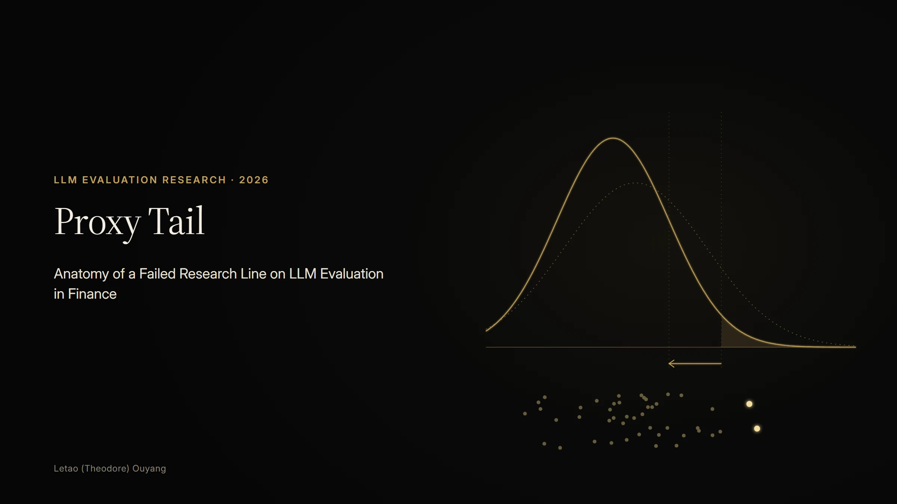
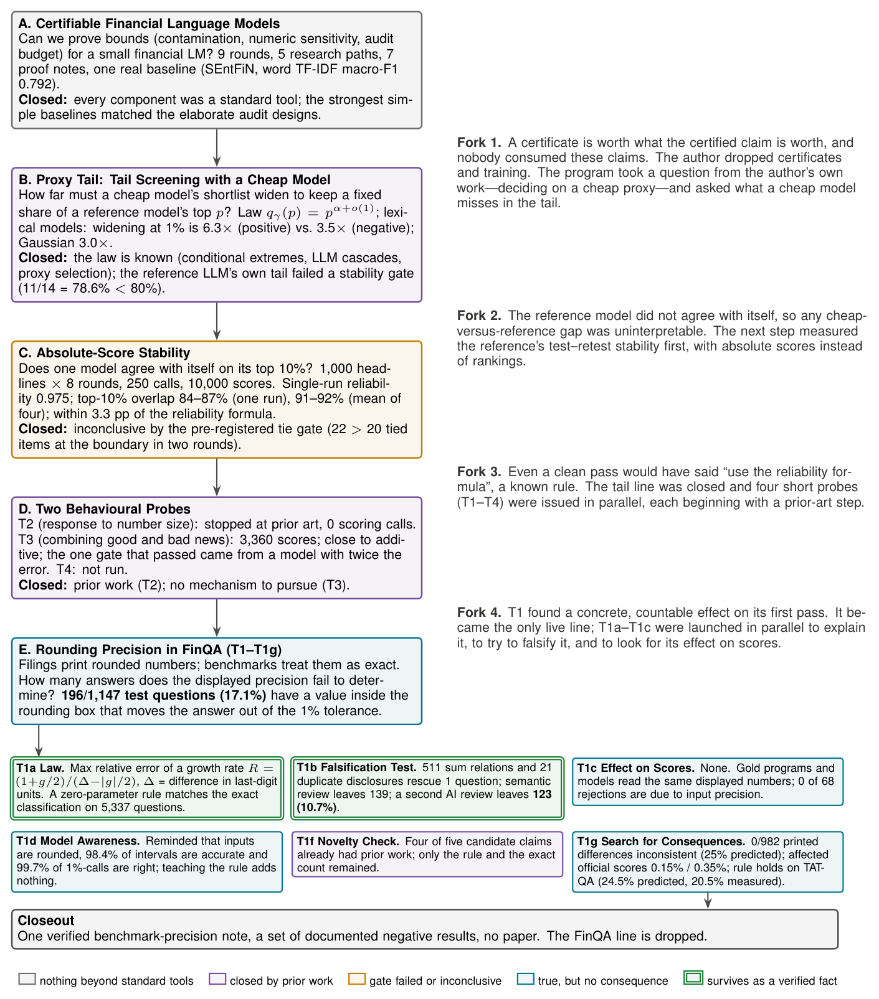
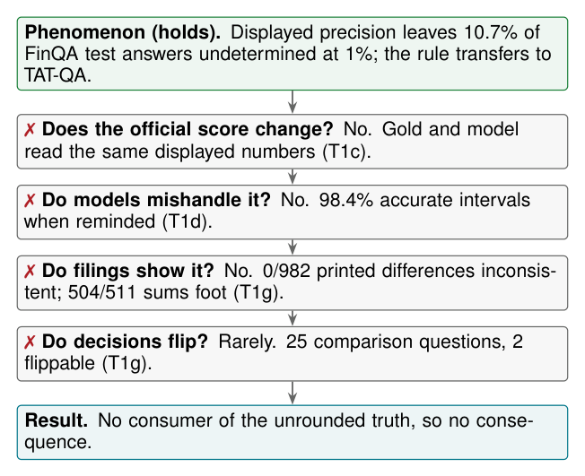

<p align="center"></p>

# Proxy Tail: Anatomy of a Failed Research Line on LLM Evaluation in Finance

**Letao (Theodore) Ouyang** · Independent research · 2026

[Read the report](report/Proxy-Tail-Anatomy-of-a-Failed-Research-Line-on-LLM-Evaluation-in-Finance.pdf) · [LaTeX source](report/src/) · [Research record](research/README.md) · [Task briefs](tasks/) · [Reproduce](REPRODUCE.md)

**Why did five stages of careful experiments end without a paper, and how early could each stage have been closed?**

This repository documents a research program on LLM evaluation in finance that was designed to
produce a paper at a top NLP venue and did not. It passed through five stages and four pivots and
ended without a publishable result. The repository keeps the complete record: every task brief,
prompt, raw model output, analysis script, pre-registered gate, review and dead end. The report
explains why the program failed, what it learned, and how the same failure could be avoided at a
fraction of the cost.

**Status: closed.** Nothing here is ongoing work.

---

## The Research Route



Stages run top to bottom; the text beside each arrow gives the reason for the turn. Colours give the
reason each box was closed, not whether it was finished. This is Figure 1 of the report.

## Why the Program Failed

A result at the level we aimed for needs three conditions at once: it must be **new**, it must have
a **consequence** that some reader would act on, and its **evidence** must be complete. Every stage
failed on novelty or consequence; the only condition the program reliably delivered was evidence.
This is not a coincidence. Novelty and consequence are cheap to test (hours of reading), evidence is
expensive (thousands of model calls), and a sound plan tests the cheap conditions first. AI agents
made evidence nearly free to *start*, so each stage began with an experiment and ended with a
novelty or consequence check. The report traces this single root cause through its three forms —
**method before phenomenon**, **novelty checked late**, and **count before consequence** — and
shows, with the program's own data, the earliest signal that could have closed each stage and how
little it would have cost to read it.

A concrete example. The rounding line (Stage E) measured a real effect: for about one FinQA test
question in ten, the precision printed in the filing cannot pin the answer down to the benchmark's
1% tolerance. More than 1,500 model sessions later, it was clear that this changes no official
score. The reason is visible in the benchmark's definition: the gold answer is a program run on the
displayed numbers, and models read the same displayed numbers. Uncertainty about the *unrounded*
truth is invisible to every score that shares that convention. Reading the scorer would have shown
this before the first experiment.

<p align="center"></p>

## Practical Significance

A positive result tells readers that one path works. A well-documented failure tells them which
paths do not, why, and how cheaply they could have found out. That second kind of knowledge is the
more transferable one here.

| Audience | What This Failure Shows | What to Do Differently |
|---|---|---|
| **Researchers working with AI agents** | Execution becomes cheap and the choice of question becomes the bottleneck. Cheap experiments crowd out the cheap reading that would have closed each stage; agents apply gates literally and drift toward verifiable paperwork. | Answer the five questions below in writing before any agent runs an experiment; give reading and novelty checks their own budget; write every gate with a fallback. |
| **Builders and users of financial QA benchmarks** | About 10% of FinQA test answers are not determined at 1% by the displayed inputs; a zero-parameter rule finds them and transfers to TAT-QA; filings are self-consistent at display precision. | Flag precision-undetermined items or derive item-level tolerances from displayed precision; read small differences near the accuracy ceiling with caution; do not estimate real rates with independent-rounding models. |
| **Practitioners screening financial text with LLM scores** | One run reproduces 84–87% of its own top decile; four averaged runs reach 91–92%, as the reliability formula predicts; 0–100 scales create ties at list boundaries. | Size repetition by the reliability formula; prefer averaged absolute scores to single rankings; report tie-aware list sizes. |
| **Advisors, reviewers and funders** | Pre-registered gates, a committed prediction and a falsification test on the best finding made every negative verdict credible and fast to reach. | Ask for the cost audit and the falsification tests alongside the results; credit documented negative results as research outputs. |

## Five Questions to Answer before the First Experiment

1. **Who Consumes the Answer?** Name the score, decision or price that changes if the hypothesis is
   true. For a benchmark defect, read the scorer and check that the defect passes through it.
2. **Has It Been Done?** Two hours on prior art, including the last twelve months of preprints and
   code repositories, searched by someone other than the proposer.
3. **What Is the Cheapest Falsification Test, and Does It Run First?**
4. **Can the Instrument Resolve the Gate?** From pilot data, compute granularity, ties and the
   chance that the gate passes under a plausible truth. Two of our gates could not: one failed by a
   single item out of 14, the other had a 40–70% chance of a tie breach before it ran.
5. **Is Our Edge Decisive Here?** If the mathematics is textbook and the field is crowded, expect to
   lose the race to novelty.

## Results That Survive

- **A verified benchmark-precision note.** A zero-parameter rule predicts which financial-QA answers
  the displayed precision cannot determine. On FinQA, 123 of 1,147 test questions (10.7%) remain
  undetermined at 1% after duplicate disclosures, sum constraints and two independent AI semantic
  reviews. Out of sample on TAT-QA, the prediction committed before measuring was 24.5%; the
  measurement was 20.5%. The underlying mathematics is textbook (cancellation in a difference of
  close numbers).
- **A negative result about consequences.** This indeterminacy changes almost no official score
  (0.15% of FinQA and 0.35% of TAT-QA scored items). Filings are self-consistent at their displayed
  precision (0 of 982 printed differences inconsistent; 504 of 511 sum relations foot exactly), so
  independent-rounding models should not be used to estimate real rates.
- **Measurement facts for LLM scoring.** One model scoring 1,000 financial headlines has single-run
  reliability 0.975; its top-10% list overlaps 84–87% with an independent run and 91–92% after
  averaging four runs, close to the Spearman–Brown prediction.

## How the Work Was Done

One human and two kinds of AI participants:

- **The author** (Letao (Theodore) Ouyang) set the constraints — no own GPU, no model training,
  theory first — and made every stop/continue decision.
- **The advisor** (Claude, called "Fable" throughout the documents) proposed directions, wrote the
  task briefs with pre-registered decision rules, and recomputed key numbers before ruling.
- **The students** (OpenAI Codex with GPT-family models, named in the records as `gpt-6-sol`,
  `gpt-6-astra`, `gpt-6.1-sol`, "Luna" and "Sol") executed the tasks and wrote most of the notes.
  Semantic reviews and adjudications were also performed by AI models. No human annotation was
  collected.

Documents that address "Fable" or "Theodore" were written by the students for the advisor and the
author. They are kept as written.

## Repository Map

| Path | Contents |
|---|---|
| [`report/`](report/) | The report (PDF), its LaTeX source, and the figures used on this page |
| [`tasks/`](tasks/) | Every task brief the advisor issued, with its outcome |
| [`research/`](research/) | One folder per stage or task: protocols, prompts, raw outputs, analysis code, results, reviews. Start with [`research/README.md`](research/README.md) |
| [`source_materials/`](source_materials/) | Snapshot of the earlier 130U-FinLLM project and the source audits used in Stage A |
| [`archive/`](archive/) | Historical front pages, the roadmap as it stood before closeout, and the abandoned paper draft |
| [`REPRODUCE.md`](REPRODUCE.md) | How to recompute the saved results without calling any model |

**Reading Guide.** Five minutes: this page. Thirty minutes: the
[report](report/Proxy-Tail-Anatomy-of-a-Failed-Research-Line-on-LLM-Evaluation-in-Finance.pdf). An
afternoon: the report, then the one-page summaries of each stage linked from
[`research/README.md`](research/README.md), then the raw records of whichever stage you doubt.

## About This Version

The working documents were written in Chinese. For this public release every document, comment
and free-text data field was translated into English; numbers, code logic, prompts, raw model outputs
and link targets were not changed. A few strings that scripts write into reports were translated in
both places so that rerunning a script still reproduces its report. Two test inputs that were
Chinese text were replaced by non-English text that tests the same thing, and one full-width comma
inside a quoted TAT-QA question became an ASCII comma. Local absolute paths in run records were
replaced by placeholders such as `<workspace>`. Delivery bundles that duplicated other files (ZIP
packages, a concatenated review bundle, reading-copy PDFs) were removed. The state at closeout, in
the original language and with every removed file, is preserved under the repository's
[closeout tag](https://github.com/130U/RESEARCH-Proxy-Tail-Anatomy-of-a-Failed-Research-Line-on-LLM-Evaluation-in-Finance/tree/closeout-2026-11-17).

Some old records pin other files by SHA-256. Those hashes refer to the original bytes; checks that
verify them will fail on translated files and should be run against the closeout tag.

## Data and Licences

The FinQA and TAT-QA datasets are downloaded by the scripts and are not stored here; excerpts that
appear in prompts and per-question records stay under the datasets' own licences (FinQA: MIT, licence
file in [`research/t1c_models/inputs/`](research/t1c_models/inputs/); TAT-QA: CC BY 4.0). SEntFiN
(MIT) is stored with its licence in
[`source_materials/130U-FinLLM/data/raw/candidates/sentfin/`](source_materials/130U-FinLLM/data/raw/candidates/sentfin/).
FOMC minutes are public records of the Federal Reserve Board. No licence has been chosen yet for the
project's own code and text.

## Citation

```bibtex
@techreport{ouyang2026proxytail,
  title       = {Proxy Tail: Anatomy of a Failed Research Line on {LLM} Evaluation in Finance},
  author      = {Ouyang, Letao (Theodore)},
  year        = {2026},
  institution = {Independent Researcher},
  url         = {https://github.com/130U/RESEARCH-Proxy-Tail-Anatomy-of-a-Failed-Research-Line-on-LLM-Evaluation-in-Finance}
}
```
