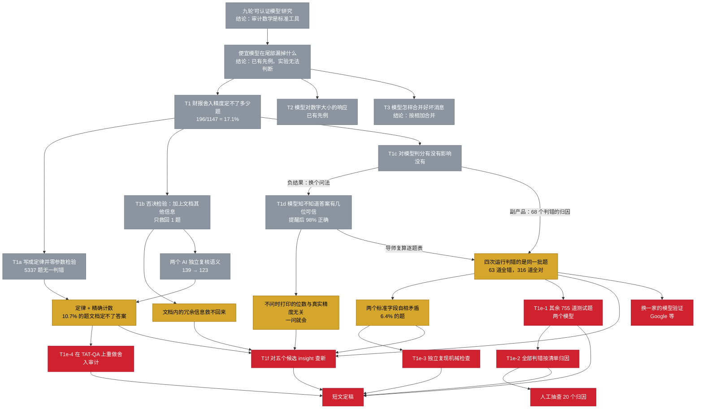

# Proxy Tail：探索链路图

更新：2026-11-17。本页是整个项目的地图：做过什么、为什么做、得到什么、还没做什么。

**当前目标：** 一篇 ACL 短文。初稿：[paper/finqa_short_v0.md](paper/finqa_short_v0.md)。

**一句话：** 模型在 FinQA 上已经到顶，剩下的"错误"几乎都出在基准一侧；即使把标准答案全改对，财报数字的舍入精度也定不了约十分之一的题的答案。

## 图例

颜色只表示**研究价值**，不表示做没做完。

| 标记 | 含义 |
|---|---|
| 🟢 | **可以出文章的成果。** 两个条件都满足：查新确认没人做过；证据完整。有一个 🟢，文章就成立 |
| 🟡 | **值得探索的候选。** 目前只是"导师没检索到有人做过"，或者证据还不完整 |
| ⚪ | **不再重点研究。** 两种情况：方向已关闭；或者是必经的一步，但别人已有相似的观点 |
| 🔴 | 还没做的任务 |

**现在没有 🟢。** 五条候选都还是 🟡，要等 T1f 查新和 T1e 补全证据之后才能定。

## 链路图

## 每一步的目的和结果

### 主线

第一列是研究价值：⚪ 表示这一步已走完，它本身不是卖点（必经之路或已有相似观点）；它产出的候选 insight 另见下一张表。

| | 步骤 | 为什么做 | 结果 | 材料 |
|---|---|---|---|---|
| ⚪ | **T1** 舍入精度 | 基准把表里的数字当精确值，但财报数字是舍入过的。想知道有多少题的答案因此定不下来 | 测试集 196/1,147 道（17.1%）存在符合显示精度、却让答案超出 1% 容差的输入 | 分支 `task/t1` |
| ⚪ | **T1a** 定律 | 一个计数不够，需要一条能事先预测的规则 | 两数须相差约 100 个末位单位，增长率才精确到 1%。不带拟合参数，5,337 题无一判错。先验预测 41.5%，实测 40.5% | 分支 `task/t1a` |
| ⚪ | **T1b** 否决检验 | 文档里还有重复披露和加总关系，可能把答案重新确定下来。如果能，T1 就不成立 | 511 条加总关系和 21 处重复披露只救回 1 道题。语义有问题的题剔除后剩 139 道 | 分支 `task/t1b` |
| ⚪ | **T1c** 对判分的影响 | 如果不影响模型评测，T1 只是一条注记 | **负结果。** 标准答案和模型用的是同一批显示数字，判分不受影响。副产品：68 个判错里大部分看起来不是模型的错 | 分支 `task/t1c` |
| ⚪ | **T1d** 模型知不知道精度 | T1c 是负结果，换一个现有基准测不了的问题：模型能否说出自己的答案有几位可信 | 提醒"数字是舍入过的"之后，98.4% 的回答给出正确区间；教规则没有额外帮助。第二个 AI 复核后 139 → 123 | 学生本地 `proxy-tail-t1d`，尚未推送 |
| 🔴 | **T1e** 做到整个测试集 | 下面的 🟡4 目前只在 392 道分层样本上成立，审稿人不会接受 | 未做 | [任务](tasks/T1e_full_test.md) |
| 🔴 | **T1f** 查新 | 🟡 只是"我没检索到"，需要另一个模型认真查一遍 | 未做 | [任务](tasks/T1f_novelty.md) |
| 🔴 | 换一家的模型 | 现在所有运行都来自 OpenAI。别家的模型如果也在同一批题上被判错，证据强得多 | 未做，等 Google 等的 token | T1e 可选项 |
| 🔴 | 人工抽查 20 个归因 | 归因全是 AI 做的，审稿人一定会问 | 未做，约 20 分钟 | T1e 可选项 |
| 🔴 | 短文定稿 | — | 初稿已写，带 † 的数字等 T1e | [初稿](paper/finqa_short_v0.md) |

### 候选 insight（🟡，查新和补证据后才可能升为 🟢）

| | 内容 | 证据 | 别人已有的相似观点 | 升为 🟢 还差什么 |
|---|---|---|---|---|
| 🟡1 | **舍入定律在基准上的检验和精确计数。** 至少 10.7% 的测试题，财报本身定不了 1% 以内的答案；增长率题里 40% | T1、T1a、T1b、两次语义复核 | 数学是经典内容；Gittings（1991）研究过舍入对增长率的扭曲；XBRL 规范已有舍入区间 | T1f 查新；T1e-4 在第二个数据集上重现 |
| 🟡2 | **文档内的冗余信息救不回来。** | T1b：只救回 1/196 | XBRL 规范里有重复事实取交集和加总一致性检查 | T1f 查新 |
| 🟡3 | **模型知道精度但不主动用。** 不问时打印的位数与真实精度的相关为 0.02；提醒一句后区间 98% 正确 | T1d | 语言模型的不确定性表达和校准研究很多；FinanceReasoning 提到模型在数值精度上有困难 | T1f 查新；T1e-1 做到整个测试集 |
| 🟡4 | **判错的是同一批题。** 四次运行都在 81%–83%，63 道四次全错，316 道全对，只有 13 道不一致；两次复核把 68 个判错里的 55 个归到基准一侧，0 个归为明确的模型错误 | T1c、T1d，导师复算 | **已有相似观点**：FinanceReasoning（ACL 2025）修订了四个公开数据集 15.6% 的题；基准标签错误的研究很多。逐题层面"换模型也是同一批题"没检索到 | T1f 查新；T1e-1、T1e-2 做到整个测试集；换一家的模型；人工抽查 |
| 🟡5 | **两个标准字段自相矛盾。** 人工写的答案与程序算出的值在 6.4% 的题上矛盾；有 12 个判错案例里模型等于前者、不等于后者 | 导师在全部 8,281 道题上的机械检查 | 没检索到，但这类检查很容易做，被人做过的可能性不小 | T1f 查新；T1e-3 独立复现 |

### 必经之路，但别人已有相似观点（⚪）

- 舍入规则背后的数学：相近的数相减会丢有效数字，教科书内容。
- "金融问答数据集有标注错误"：已知。
- T1c 的负结果：如实写进文章，但不是卖点。

### 已关闭的方向

| | 方向 | 为什么关闭 |
|---|---|---|
| ⚪ | 九轮"可认证的金融语言模型" | 证书框架本身不产生有意思的结论；审计设计的数学是标准工具的组合。历史材料在 `research/` |
| ⚪ | 便宜模型在尾部漏掉什么 | 加宽定律、copula 建模级联、带召回约束的代理筛选都已有先例；agent 实验按预定规则判为"无法判断"。旧首页：[research/README_tail_screening_2026-11-16.md](research/README_tail_screening_2026-11-16.md) |
| ⚪ | T2 模型对数字大小的响应 | 已有先例 |
| ⚪ | T3 模型怎样合并好坏消息 | 结论是"按相加合并"，没有可继续的现象。分支 `task/t3` |
| ⚪ | T4 便宜与贵模型的头部重合 | 尾部方向关闭后不再需要 |

## 现在最不确定的三件事

欢迎直接在这三点上提意见。

1. **🟡4 能不能撑到整个测试集。** 如果 755 道新题上出现相当数量的明确模型错误，"模型已到顶"这个主结论要改。
2. **哪个 🟡 是文章的中心。** 🟡4 更有分量但新颖性只有一部分；🟡1 最新但 T1c 说明它不影响判分。初稿现在是用 🟡4 开头、🟡1 做中心。
3. **只有一个基准。** T1e-4 在 TAT-QA 上重做舍入审计，是为了回应这一点。

## 目录

| 内容 | 位置 |
|---|---|
| 任务文件 | [tasks/](tasks/README.md) |
| 短文初稿 | [paper/finqa_short_v0.md](paper/finqa_short_v0.md) |
| 各轮结果 | 分支 `task/t1`、`task/t1a`、`task/t1b`、`task/t1c`、`task/t3` |
| 历史研究 | [research/](research/README.md) |
