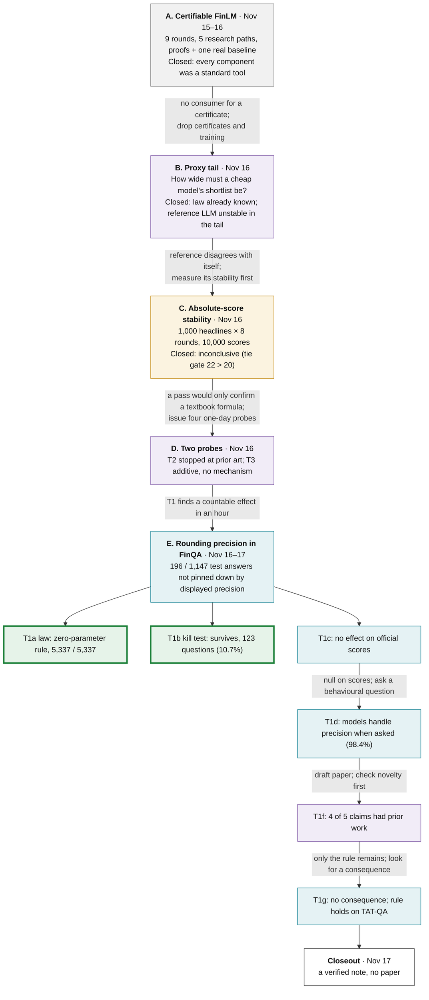

# Proxy Tail

**A research line on LLM evaluation in finance that did not work, and an account of why.**

Between 15 and 17 November 2026 this project tried to produce a paper for a top NLP venue. It passed
through five stages and four pivots and ended without a publishable result. This repository keeps
the whole record: every task brief, prompt, raw model output, analysis script, pre-registered gate,
review and dead end. The write-up is a short report in ACL format:

**📄 [Proxy Tail: Anatomy of a Failed Research Line on LLM Evaluation in Finance](report/proxy_tail_postmortem.pdf)**
(Letao (Theodore) Ouyang, November 2026; LaTeX source in [`report/src`](report/src/))

Status: **closed on 2026-11-17.** Nothing here is ongoing work.

---

## The route

Colours give the reason each stage was closed, not whether it was finished.



## Why it failed, in one paragraph

A result at the level we aimed for needs three things at once: it must be **new**, it must have a
**consequence** that some reader would act on, and its **evidence** must be complete. Every stage
failed on novelty or consequence; the only factor we reliably delivered was evidence. That is not a
coincidence. Novelty and consequence are cheap to test (hours of reading), evidence is expensive
(days of experiments), and a sensible plan tests the cheap factors first. Our agents made evidence
nearly free to *start*, so each stage began with an experiment and ended with a novelty or
consequence check. The report traces this one root cause through its three forms — **method before
phenomenon**, **novelty checked late**, and **count before consequence** — and shows, with the
project's own data, the earliest signal that could have closed each stage and how little it would
have cost to read it.

A concrete example. The rounding line (Stage E) measured a real effect: for about one FinQA test
question in ten, the precision printed in the filing cannot pin the answer down to the benchmark's
1% tolerance. It took eleven hours and more than 1,500 model sessions to learn that this changes no
official score. The reason is visible in the benchmark's definition: the gold answer is a program run
on the displayed numbers, and models read the same displayed numbers. Uncertainty about the
*unrounded* truth is invisible to every score that shares that convention. Reading the scorer would
have shown this before the first experiment.

## Five questions to answer before the first experiment

1. **Who consumes the answer?** Name the score, decision or price that changes if the hypothesis is
   true. For a benchmark defect, read the scorer and check that the defect passes through it.
2. **Has it been done?** Two hours on prior art, including the last twelve months of preprints and
   code repositories, searched by someone other than the proposer.
3. **What is the cheapest kill test, and does it run first?**
4. **Can the instrument resolve the gate?** From pilot data, compute granularity, ties and the
   chance the gate passes under a plausible truth. (Two of our gates could not: one failed by a single
   item out of 14, the other had a 40–70% chance of a tie breach before it ran.)
5. **Is our edge decisive here?** If the mathematics is textbook and the field is crowded, expect to
   lose the race to novelty.

## What survives

- **A verified benchmark-precision note.** A zero-parameter rule predicts which financial-QA answers
  the displayed precision cannot determine. On FinQA, 123 of 1,147 test questions (10.7%) remain
  undetermined at 1% after duplicate disclosures, sum constraints and two independent AI semantic
  reviews. Out of sample on TAT-QA, the prediction committed before measuring was 24.5%; the
  measurement was 20.5%. The underlying mathematics is textbook (cancellation in a difference of
  close numbers).
- **A negative result about consequences.** This indeterminacy changes almost no official score
  (0.15% of FinQA and 0.35% of TAT-QA scored items). Filings are self-consistent at their displayed
  precision (0 of 982 printed differences inconsistent; 504 of 511 sum relations foot exactly), so
  independent-rounding models should not be used to estimate real rates.
- **Measurement facts for LLM scoring.** One model scoring 1,000 financial headlines has single-run
  reliability 0.975; its top-10% list overlaps 84–87% with an independent run and 91–92% after
  averaging four runs, close to the Spearman–Brown prediction.

## How the work was done

One human and two kinds of AI participants:

- **The author** (Letao (Theodore) Ouyang) set the constraints — no own GPU, no model training,
  theory first — and made every stop/continue decision.
- **The advisor** (Claude, called "Fable" throughout the documents) proposed directions, wrote the
  task briefs with pre-registered decision rules, and recomputed key numbers before ruling.
- **The students** (OpenAI Codex with GPT-family models, named in the records as `gpt-6-sol`,
  `gpt-6-astra`, `gpt-6.1-sol`, "Luna" and "Sol") executed the tasks and wrote most of the notes.
  Semantic reviews and adjudications were also done by AI models. No human annotation was collected.

Documents that address "Fable" or "Theodore" were written by the students for the advisor and the
author. They are kept as written.

## Repository map

| Path | What is there |
|---|---|
| [`report/`](report/) | The post-mortem report (PDF) and its LaTeX source |
| [`tasks/`](tasks/) | Every task brief the advisor issued, with its outcome |
| [`research/`](research/) | One folder per stage or task: protocols, prompts, raw outputs, analysis code, results, reviews. Start with [`research/README.md`](research/README.md) |
| [`source_materials/`](source_materials/) | Snapshot of the earlier 130U-FinLLM project and the source audits used in Stage A |
| [`archive/`](archive/) | Historical homepages, the roadmap as it stood before closeout, and the abandoned paper draft |
| [`REPRODUCE.md`](REPRODUCE.md) | How to recompute the saved results without calling any model |

**Reading guide.** Five minutes: this page. Thirty minutes: the [report](report/proxy_tail_postmortem.pdf).
An afternoon: the report, then the one-page summaries of each stage linked from
[`research/README.md`](research/README.md), then the raw records of whichever stage you doubt.

## About this version

The working documents were written in Chinese. For this public release every document, comment
and free-text data field was translated into English; numbers, code logic, prompts, raw model outputs
and link targets were not changed. A few strings that scripts write into reports were translated in
both places so that rerunning a script still reproduces its report. Two test inputs that were
Chinese text were replaced by non-English text that tests the same thing, and one full-width comma
inside a quoted TAT-QA question became an ASCII comma. Local absolute paths in run records were
replaced by placeholders such as `<workspace>`. Delivery bundles that duplicated other files (ZIP packages, a concatenated
review bundle, reading-copy PDFs) were removed. The state at closeout, in the original language and with every removed file, is
preserved under the tag [`closeout-2026-11-17`](https://github.com/130U/proxy-tail/tree/closeout-2026-11-17).

Some old records pin other files by SHA-256. Those hashes refer to the original bytes; checks that
verify them will fail on translated files and should be run against the tag.

## Data and licences

The FinQA and TAT-QA datasets are downloaded by the scripts and are not stored here; excerpts that
appear in prompts and per-question records stay under the datasets' own licences (FinQA: MIT, licence
file in [`research/t1c_models/inputs/`](research/t1c_models/inputs/); TAT-QA: CC BY 4.0). SEntFiN
(MIT) is stored with its licence in
[`source_materials/130U-FinLLM/data/raw/candidates/sentfin/`](source_materials/130U-FinLLM/data/raw/candidates/sentfin/).
FOMC minutes are public records of the Federal Reserve Board. No licence has been chosen yet for the
project's own code and text.

## Citation

```bibtex
@techreport{ouyang2026proxytail,
  title       = {Proxy Tail: Anatomy of a Failed Research Line on {LLM} Evaluation in Finance},
  author      = {Ouyang, Letao (Theodore)},
  year        = {2026},
  month       = nov,
  institution = {Independent},
  url         = {https://github.com/130U/proxy-tail}
}
```
