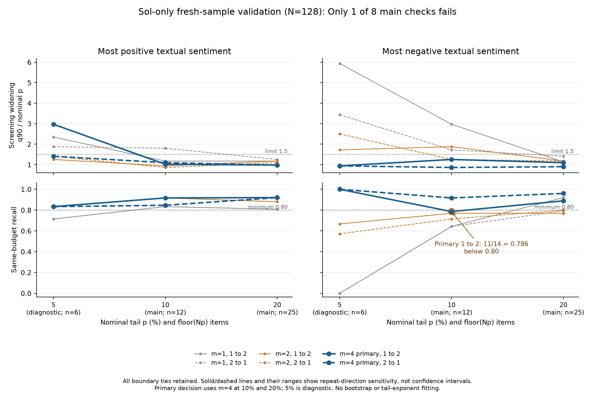

# Proxy Tail

**What does a cheap model miss in the tail? / 便宜模型在尾部漏掉什么？**

研究问题：用便宜模型筛选金融文本，要留住参考模型最极端的固定份额，名单需要放大多少？参考模型是一份比较排序，不是客观真值。

本仓库保存截至2026-11-16的完整研究：理论推导与反例、四支文献排重、词法基线、实际agent实验、失败路径、原始输入/输出、分析代码、内部复核，以及此前五条候选路径与九轮历史研究。当前研究没有训练模型或调用外部付费模型API；历史词法模型产物保留用于复算。

## 先读这些结果

- **最新实验已完成（2026-11-16）：** [绝对评分 TASK](../tasks/absolute_scoring.md) 的 1,000 条 × 八轮及两组同批对照全部执行，共 250 次评分调用、10,000 个原始分数。[给 Fable 的一页结论](../research/absolute_scoring/FABLE_ONE_PAGE.md) · [完整报告](../research/absolute_scoring/FABLE_REPORT.md) · [六面板图](../research/absolute_scoring/results/stability.png) · [复算说明](../research/absolute_scoring/REPRODUCE.md)。四次平均的 10% 双尾重合点估计约 90%–92%；**正式判定为无法判断**，因为第六、七轮正面边界同分 22 人超过预定 20 人门槛。原始分数、区间、失败原因及调度恢复细节全部保留。下列旧数字属于此前的排序与成对比较实验。
- [给Fable的一页结论](../research/tail_screening/FABLE_ONE_PAGE.md) / [PDF](https://github.com/130U/proxy-tail/blob/closeout-2026-11-17/research/tail_screening/output/pdf/FABLE_ONE_PAGE.pdf)
- [当前完整报告](../research/tail_screening/FABLE_CURRENT_REPORT.md) / [6页PDF](https://github.com/130U/proxy-tail/blob/closeout-2026-11-17/research/tail_screening/output/pdf/FABLE_CURRENT_REPORT.pdf)
- [全部交付材料入口](https://github.com/130U/proxy-tail/blob/closeout-2026-11-17/research/FABLE_DELIVERY_README.md)
- [原始完整交付ZIP](https://github.com/130U/proxy-tail/blob/closeout-2026-11-17/research/FABLE_FULL_DELIVERY_2026-11-16.zip)：此前已交付的371文件快照；仓库另补充来源材料与路径适配。

**已执行64次评分agent任务，覆盖三批共288个不同词法族。** 另有两次496对整批尝试没有产生输出，已保留记录。重复评分不是新的独立金融样本。

| 测量路线 | 全新32条第一阶段 | 后续 |
|---|---|---|
| 成对比较 | Luna、Sol均未通过 | 保留3,968个判断及失败原因 |
| 四次排序聚合 | Luna未通过，Sol单模型通过 | Sol扩大到全新128条 |
| Sol四次聚合确认 | 128条上八项主检查七项通过 | 负面10%一个方向召回11/14=78.6%，略低于80%；按冻结规则不进入512条 |

确认集总体Spearman为0.9929，最大90%召回放行倍数1.25，最大边界同分扩张16.7%。聚合有改善，但接近门槛的未通过不能改判成功，也不证明总体显著失效或原尾部假说错误。独立实现已复算关键结果一致。[第一阶段](../research/tail_screening/stage1_conclusion.md) · [128条确认](../research/tail_screening/stage2_report.md) · [内部AI复核](../research/tail_screening/measurement_peer_review.md)

## 数学与新颖性边界

令qγ(p)为留住参考最高p比例中份额γ所需的代理放行比例。明确条件下的Laplace条件极值假设给出 **qγ(p)=p^{α+o(1)}**，一般不能直接写成C p^α；**α=1仍可能有发散放行倍数**。正相关高斯的α=ρ²已有先例，ρ指正态分数相关。多级α相乘还需联合或Markov条件。

Copula建模LLM级联、极端预测的尾依赖、召回约束代理筛选均已有研究。本仓库没有声称已建立新的LLM尾部定律、估计渐近α或验证投资价值。[完整推导](../research/tail_screening/theory.md) · [文献排重](../research/tail_screening/literature.md)

最初首页原文完整保存在[初始研究说明](../research/advisor_reference/proxy_tail_initial_README.md)，其猜想与计划按当时状态阅读。

## 原始细节与历史材料

| 内容 | 位置 |
|---|---|
| 冻结协议、聚合公式及复算 | [方法协议](../research/tail_screening/methods_protocol.md)、[聚合定义](../research/tail_screening/aggregation_math.md)、[复算说明](../REPRODUCE.md) |
| 旧128条开发：两版提示与八份原始评分 | [agent_tail_pilot](../research/private/agent_tail_pilot/) |
| 新32条：完整pair和rank输入、原始判断、映射及种子 | [stage1_n32](../research/private/agent_tail_methods/stage1_n32/) |
| 新128条：八份输入与八份原始排序 | [stage2_n128_sol](../research/private/agent_tail_methods/stage2_n128_sol/) |
| 来源样本、划分、保存的词法模型及逐条预测 | [real_baseline](../research/private/real_baseline/) |
| 此前五条候选路径及九轮历史研究 | [五路径比较](../research/paths/COMPARATIVE_ANALYSIS.md)、[历史总报告](../research/FABLE_FULL_REPORT.md)、[逐文件索引](../research/INDEX.md) |
| 原导师材料、决策与审查 | [advisor_reference](../research/advisor_reference/)、[reports](../research/reports/) |
| 审计引用的旧项目、数据许可与来源快照 | [source_materials](../source_materials/README.md) |

`private`是先前本地目录名；本次按项目所有者要求纳入此私有仓库。旧元数据中的本机绝对路径只记录来源，不是凭据。各阶段报告、ZIP和清单保持历史身份，不把未执行计划改写成成果。

材料供Theodore转交Fable。内部AI复核不等于Fable本人或外部真人审稿。
