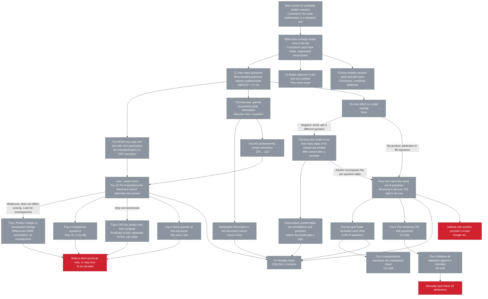

# Proxy Tail: exploration map

Updated: 2026-11-17 (after T1g). This page is the map of the whole project: what was done, why it was done, what came of it, and what has not been done yet.

**Current goal:** an ACL short paper. Draft: [paper/finqa_short_v0.md](finqa_short_paper_draft_v0.md).

**In one sentence:** models have reached the ceiling on FinQA, and the remaining "errors" are almost all on the benchmark side; even if every gold answer were corrected, the rounding precision of filing figures cannot determine the answer for about one in ten questions.

## Legend

Colours indicate only **research value**, not whether something is finished.

| Marker | Meaning |
|---|---|
| 🟢 | **A result that can become a paper.** Both conditions hold: the novelty check confirms that no one has done it, and the evidence is complete. A single 🟢 is enough for the paper to stand |
| 🟡 | **A candidate worth exploring.** So far this only means "the advisor found no one who has done it", or the evidence is not yet complete |
| ⚪ | **No longer a focus.** Two cases: the direction is closed; or it is a necessary step, but others already hold a similar view |
| 🔴 | A task not yet done |

**There is currently no 🟢 and no 🟡.** The T1g conclusion: the only remaining candidate (the rounding law) holds on a second dataset, but no setting can be found where it has consequences. It is downgraded to ⚪: a verified note on benchmark precision.

## Map

## What each step was for and what it produced

### Main line

The first column is research value: ⚪ means the step is finished and is not itself a selling point (a necessary step, or others hold a similar view); the candidate insights it produced are listed in the next table.

| | Step | Why it was done | Result | Materials |
|---|---|---|---|---|
| ⚪ | **T1** Rounding precision | The benchmark treats the numbers in the tables as exact, but filing figures are rounded. We wanted to know for how many questions this leaves the answer undetermined | On the test set, 196/1,147 questions (17.1%) have inputs that are consistent with the displayed precision yet push the answer outside the 1% tolerance | Branch `task/t1` |
| ⚪ | **T1a** Law | A count is not enough; we need a rule that predicts in advance | Two figures must differ by about 100 last-digit units for the growth rate to be exact to 1%. With no fitted parameters, no misclassification on 5,337 questions. A priori prediction 41.5%, observed 40.5% | Branch `task/t1a` |
| ⚪ | **T1b** Veto test | The document also contains duplicate disclosures and sum relations, which might pin the answer down again. If they do, T1 does not hold | 511 sum relations and 21 duplicate disclosures rescue only 1 question. After removing questions with semantic problems, 139 remain | Branch `task/t1b` |
| ⚪ | **T1c** Effect on scoring | If it does not affect model evaluation, T1 is only a note | **Negative result.** The gold answer and the model use the same displayed figures, so scoring is unaffected. By-product: most of the 68 rejections do not look like the model's fault | Branch `task/t1c` |
| ⚪ | **T1d** Does the model know the precision | T1c was a negative result, so ask a question that existing benchmarks cannot measure: can the model say how many digits of its answer are reliable | After a reminder that "the figures are rounded", 98.4% of answers give the correct interval; teaching the rule gives no extra help. After review by a second AI, 139 → 123 | Student local `proxy-tail-t1d`, not yet pushed |
| ⚪ | **T1e** Extend to the whole test set | Originally prepared for candidates 4 and 5. After the novelty check, both have prior work | On hold. Its TAT-QA part was merged into T1g | [Task](../tasks/T1e_full_test.md) |
| ⚪ | **T1g** Where rounding precision has consequences | The only remaining candidate does not affect current scoring. Find a setting where it has visible consequences, and test the rule on a second dataset | **No consequence found.** Printed differences vs recomputed values: 0/982 inconsistent (the independent-rounding model predicted 25%); affected questions: FinQA 0.15%, TAT-QA 0.35%; only 25 questions compare computed quantities. The rule holds on TAT-QA: predicted 24.5%, observed 20.5%, first-order rule 100% consistent | Student local `proxy-tail-t1g`, branch `task/t1g` not yet pushed |
| ⚪ | **T1f** Novelty check | 🟡 only means "I found nothing"; another model needs to search carefully | Item 1 remains; items 2–5 have prior work | Branch `task/t1f` |
| 🔴 | Another provider's model | All runs so far come from OpenAI. If other providers' models are also marked wrong on the same questions, the evidence is much stronger | Not done; waiting for tokens from Google etc. | T1e optional item |
| 🔴 | Manual spot-check of 20 attributions | All attributions were made by AI; reviewers will certainly ask | Not done, about 20 minutes | T1e optional item |
| 🔴 | Final short paper | — | Draft written; numbers marked † wait for T1e | [Draft](finqa_short_paper_draft_v0.md) |

### Candidate insights: status after the T1f novelty check

| | Content | Evidence | Similar views others already hold | What is still missing to become 🟢 |
|---|---|---|---|---|
| ⚪1 | **Test and exact count of the rounding law on a benchmark.** For at least 10.7% of test questions, the filing itself cannot determine the answer to within 1%; for growth-rate questions, 40% | T1, T1a, T1b, T1g | T1f found no identical measurement. But "a rounded label corresponds to a set" already appears in November 2026 work (arXiv 2611.02461, used for training) | **Downgraded to a note.** The rule holds on two datasets, but it does not affect scoring, no contradiction is visible in the documents, comparison questions are almost unaffected, and the model gets it right as soon as it is asked |
| ⚪2 | **Redundant information in the document cannot rescue them.** | T1b: only 1/196 rescued | **Prior work exists.** The XBRL specification §5.5 intersects duplicate disclosures; Dandekar (2010) and Salazar-González (2005) use sum constraints plus linear programming to recover pre-rounding values | Not a separate point. "Only 1/196 rescued in FinQA" serves as robustness evidence for item 1 |
| ⚪3 | **The model knows the precision but does not use it unprompted.** Unprompted, the correlation between printed digits and true precision is 0.02; after one reminder, 98% of intervals are correct | T1d | **Prior work exists.** A before/after-prompt comparison on chemistry significant-figure questions (2024); Gauging Overprecision in LLMs (2025) evaluated numeric intervals on FinQA | Not a separate point. Merged into item 1 as a behavioural result |
| ⚪4 | **The rejections fall on the same questions.** All four runs are at 81%–83%; 63 questions are wrong in all four, 316 right in all four, and only 13 are inconsistent; two reviews attribute 55 of the 68 rejections to the benchmark side and 0 to a definite model error | T1c, T1d, advisor recomputation | **Prior work exists.** FinanceReasoning (ACL 2025) revised 795 CodeFinQA questions; T1f says FINESSE-Bench (2026) counted rejections shared across many models (the advisor only verified that the paper exists, and it reports that other providers' models also score 0.79–0.83 on FinQA) | Not a separate point. Serves as evaluation background. The per-question attribution of 55/68 is a new audit, but "the same questions" itself is not new |
| ⚪5 | **The two gold fields contradict each other.** The human-written answer and the value computed by the program contradict each other on 6.4% of questions; in 12 rejection cases the model equals the former but not the latter | The advisor's mechanical check over all 8,281 questions | **Prior work exists.** PR #4 of EnvCommons/FinQA (merged 2026-10) already compared the two fields and filtered questions by them; FinQAPT (2024) mentioned it earlier | Not a separate point. Cited as background |

### Necessary steps on which others already hold similar views (⚪)

- The mathematics behind the rounding rule: subtracting nearby numbers loses significant digits; textbook material.
- "Financial QA datasets have annotation errors": known.
- The negative result of T1c: reported as it is in the paper, but not a selling point.

### Closed directions

| | Direction | Why it was closed |
|---|---|---|
| ⚪ | Nine rounds of "certifiable financial language models" | The certificate framework itself yields no interesting conclusions; the mathematics of the audit design is a combination of standard tools. Historical materials are in `research/` |
| ⚪ | What does a cheap model miss in the tail | The widening law, copula modelling of cascades, and recall-constrained proxy screening all have prior work; the agent experiment was judged "inconclusive" under the pre-registered rules. Old homepage: [research/README_tail_screening_2026-11-16.md](README-tail-screening-stage.md) |
| ⚪ | T2 Model response to the size of a number | Prior work exists |
| ⚪ | T3 How models combine good and bad news | The conclusion is "combined additively"; there is no phenomenon to pursue further. Branch `task/t3` |
| ⚪ | T4 Top-list overlap between cheap and expensive models | No longer needed after the tail direction was closed |

## Where things stand

1. **This line has yielded what it can.** A rule with no fitted parameters, validated on two datasets, plus a set of honestly recorded negative results. Its weight is that of a short technical note, not a top-conference paper.
2. **A hypothesis refuted by real data.** The advisor had earlier estimated, assuming that "each figure is rounded independently", that a quarter of the printed differences should fail to match. The observed value is 0/982, and of the existing 511 sum relations only 7 have residuals. Filing tables are self-consistent at the displayed precision, and a probability model of independent rounding cannot be used to estimate the real incidence. Every expected count in the draft that is based on this model must be deleted.
3. **Next step to be decided:** write this line up as a short note and close it, then find another topic; or find another topic directly.

## Contents

| Content | Location |
|---|---|
| Task files | [tasks/](../tasks/README.md) |
| Short-paper draft | [paper/finqa_short_v0.md](finqa_short_paper_draft_v0.md) |
| Results of each round | Branches `task/t1`, `task/t1a`, `task/t1b`, `task/t1c`, `task/t3` |
| Historical research | [research/](../research/README.md) |
