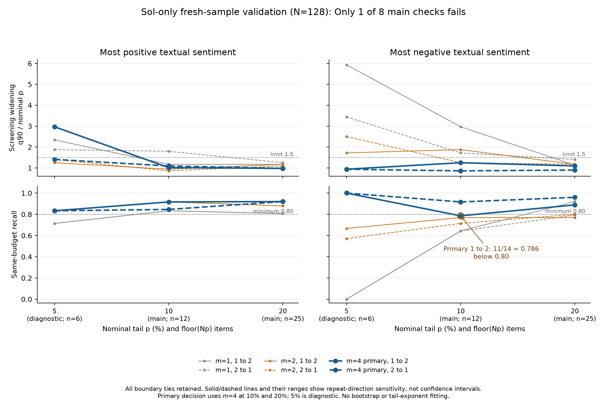

# Proxy Tail

**What does a cheap model miss in the tail?**

Research question: when a cheap model screens financial text, how much must the list be widened to keep a fixed share of the reference model's most extreme items? The reference model is a comparative ranking, not an objective ground truth.

This repository holds the complete research up to 2026-11-16: theoretical derivations and counterexamples, four separate literature prior-art checks, a lexical baseline, real agent experiments, failed paths, raw inputs/outputs, analysis code, internal reviews, and the earlier five candidate paths and nine rounds of historical research. The current research did not train models or call external paid model APIs; the historical lexical-model artifacts are kept for recomputation.

## Read these results first

- **The latest experiment is complete (2026-11-16):** the [absolute scoring TASK](../tasks/absolute_scoring.md), 1,000 items × eight rounds plus two same-batch control groups, was run in full: 250 scoring calls and 10,000 raw scores. [One-page summary for Fable](../research/absolute_scoring/FABLE_ONE_PAGE.md) · [full report](../research/absolute_scoring/FABLE_REPORT.md) · [six-panel figure](../research/absolute_scoring/results/stability.png) · [recomputation notes](../research/absolute_scoring/REPRODUCE.md). The point estimate of the 10% two-tailed overlap for the four-run average is about 90%–92%; **the formal verdict is inconclusive**, because in rounds six and seven the positive-side boundary-tie group held 22 items, above the pre-registered gate of 20. Raw scores, intervals, failure reasons and the details of scheduling recovery are all kept. The older numbers below belong to the earlier ranking and pairwise comparison experiments.
- [One-page summary for Fable](../research/tail_screening/FABLE_ONE_PAGE.md) / [PDF](https://github.com/130U/Proxy-Tail-Anatomy-of-a-Failed-Research-Line-on-LLM-Evaluation-in-Finance/blob/closeout-2026-11-17/research/tail_screening/output/pdf/FABLE_ONE_PAGE.pdf)
- [Current full report](../research/tail_screening/FABLE_CURRENT_REPORT.md) / [6-page PDF](https://github.com/130U/Proxy-Tail-Anatomy-of-a-Failed-Research-Line-on-LLM-Evaluation-in-Finance/blob/closeout-2026-11-17/research/tail_screening/output/pdf/FABLE_CURRENT_REPORT.pdf)
- [Entry point to all deliverables](https://github.com/130U/Proxy-Tail-Anatomy-of-a-Failed-Research-Line-on-LLM-Evaluation-in-Finance/blob/closeout-2026-11-17/research/FABLE_DELIVERY_README.md)
- [Original full delivery ZIP](https://github.com/130U/Proxy-Tail-Anatomy-of-a-Failed-Research-Line-on-LLM-Evaluation-in-Finance/blob/closeout-2026-11-17/research/FABLE_FULL_DELIVERY_2026-11-16.zip): the 371-file snapshot delivered earlier; the repository additionally adds source materials and path adjustments.

**64 scoring agent tasks were run, covering three batches with 288 distinct lexical families in total.** Two further attempts to score a full batch of 496 pairs produced no output; their records are kept. Repeated scoring is not a new independent financial sample.

| Measurement route | New 32-item stage one | Follow-up |
|---|---|---|
| Pairwise comparison | Luna and Sol both failed | 3,968 judgments and failure reasons kept |
| Four-run rank aggregation | Luna failed; Sol passed as a single model | Sol extended to a new set of 128 items |
| Sol four-run aggregation confirmation | On 128 items, seven of eight main checks passed | Negative 10%, one direction: recall 11/14=78.6%, just below 80%; under the frozen rules it does not proceed to 512 items |

On the confirmation set the overall Spearman is 0.9929, the maximum widening factor for 90% recall is 1.25, and the maximum boundary-tie expansion is 16.7%. Aggregation helps, but a failure close to the gate cannot be re-judged as a success, and it does not show a significant overall breakdown or that the original tail hypothesis is wrong. An independent implementation recomputed the key results and they agree. [Stage one](../research/tail_screening/stage1_conclusion.md) · [128-item confirmation](../research/tail_screening/stage2_report.md) · [internal AI review](../research/tail_screening/measurement_peer_review.md)

## Mathematical and novelty boundaries

Let qγ(p) be the proxy pass-through fraction needed to keep a share γ of the reference's top p fraction. An explicit Laplace conditional-extremes assumption gives **qγ(p)=p^{α+o(1)}**, which in general cannot be written directly as C p^α; **with α=1 the widening factor can still diverge**. For a positively correlated Gaussian, α=ρ² has prior work, where ρ is the correlation of the normal scores. Multiplying α across several stages also needs joint or Markov conditions.

Copula modelling of LLM cascades, tail dependence of extreme predictions, and recall-constrained proxy screening have all been studied. This repository does not claim to have established a new LLM tail law, estimated an asymptotic α, or validated investment value. [Full derivation](../research/tail_screening/theory.md) · [literature prior-art check](../research/tail_screening/literature.md)

The original text of the first homepage is kept in full in the [initial research notes](../research/advisor_reference/proxy_tail_initial_README.md); read its conjectures and plans as they stood at the time.

## Raw details and historical materials

| Content | Location |
|---|---|
| Frozen protocol, aggregation formulas and recomputation | [methods protocol](../research/tail_screening/methods_protocol.md), [aggregation definitions](../research/tail_screening/aggregation_math.md), [recomputation notes](../REPRODUCE.md) |
| Old 128-item development: two prompt versions and eight raw scorings | [agent_tail_pilot](../research/private/agent_tail_pilot/) |
| New 32 items: full pair and rank inputs, raw judgments, mappings and seeds | [stage1_n32](../research/private/agent_tail_methods/stage1_n32/) |
| New 128 items: eight inputs and eight raw rankings | [stage2_n128_sol](../research/private/agent_tail_methods/stage2_n128_sol/) |
| Source sample, splits, saved lexical models and per-item predictions | [real_baseline](../research/private/real_baseline/) |
| The earlier five candidate paths and nine rounds of historical research | [five-path comparison](../research/paths/COMPARATIVE_ANALYSIS.md), [historical full report](../research/FABLE_FULL_REPORT.md), [per-file index](../research/INDEX.md) |
| Original advisor materials, decisions and reviews | [advisor_reference](../research/advisor_reference/), [reports](../research/reports/) |
| Old projects cited by the audit, data licences and source snapshots | [source_materials](../source_materials/README.md) |

`private` is the name of an earlier local directory; at the project owner's request it is included in this private repository this time. Local absolute paths in old metadata only record the source and are not credentials. Each stage's reports, ZIPs and manifests keep their historical identity; plans that were never carried out are not rewritten as results.

The materials are for Theodore to pass on to Fable. An internal AI review is not the same as a review by Fable or by an external human reviewer.
