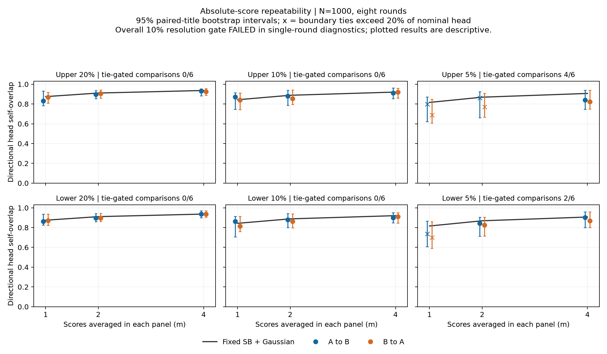

# 给 Fable 的完整交付：同一模型的头部名单稳定性

2026-11-16。**实验已经完整执行；正式结论为“无法判断”，原因是预先规定的主要并列门失格。** 四次平均在本样本的 10% 双尾重合点估计达到 90%，不能据此改判协议通过或推导新尾部定律。本报告是 Codex 的实际实验及分析，供 Theodore 转交 Fable；不代表 Fable 已评审。

## 实际完成的工作

在用户明确选择“按复现与压力测试继续评分”后，从尚未用于旧三次 agent 实验的 1,282 个测试词法族中，按冻结种子抽取 1,000 族，每族一条。固定 0–100 整数量表、五个合成锚点、每批 40 条，每轮重随机分批和次序。使用 gpt-6-sol、reasoning_effort=low、fork_turns=none，每次建立新评分上下文。

主实验 200 次调用产生 8,000 个分数。100 个对照目标分布于全部 25 个首轮批次，所以两个对照重复共 50 次调用、2,000 个伴随分数，其中仅预先选定目标的 200 个分数用于主要控制比较，另外 1,800 个分数仍完整保存。共 250 个不同评分代理任务、10,000 个原始分数；全部输出一次通过 ID、重复键和整数范围检查，评分重试为零。采集记录时间从 14:36:37 到 15:49:41 UTC，约 73.1 分钟，含调度等待，不能当成纯推理时长。

中途调度代理两次请求报 Bad Request，主代理接收已完成评分后接管第八轮，未重跑有效分数。最大并发由两个评分代理变为三个，模型与提示不变。主代理字段核对曾显示一条带旧标签的源行，随机选样与评分均未使用该标签；不能声称所有参与代理完全未见标签。详见 [执行说明](execution/notes.md)。

来源为保存版本的 SEntFiN，沿用其作者 MIT 许可及本地研究范围；来源版本、既有划分限制、族抽样种子与精确实施规则见 [冻结协议](protocol.md)。新标题原文保存在仓库外，本轮提交仅含 ID 对应、分数、合成提示、代码与汇总。词法族去重不证明事件独立，也不证明预训练未见过标题。

## 主要结果：10% 双尾

A 为第 1–4 轮，B 为第 5–8 轮；每组按相同前缀取 m=1、2、4 次原始整数分的均值。A→B 以 A 的名单为参考分母，B→A 反向。边界同分全部保留，因此两份实际名单可能不一样大。下表两端范围是两个方向的点估计，不是置信区间。

| 平均次数 m | 最高 10% 重合 | 最低 10% 重合 | 固定高斯预测（双端相同） |
|---|---:|---:|---:|
| 1 | 84.1%–87.2% | 81.3%–86.1% | 84.3% |
| 2 | 85.6%–88.1% | 86.3%–88.0% | 88.8% |
| 4 | 91.1%–92.0% | 90.1%–91.0% | 92.1% |

单次与两次平均在四个主要方向的点估计均未达到 90%；四次平均的四项点估计首次均达到 90%。但是四次平均的逐项区间下限约为 84.5%–86.1%，不能宣称总体达到或保证 90%，也不能推断最小充分重复次数恰好为四次。

| m | 尾部 | 参考方向 | 交集 / 参考人数 | 重合 | 95% 区间 | 预测 | 实测减预测的 95% 区间 |
|---|---|---|---:|---:|---|---:|---|
| 1 | 正面 | A→B | 95/109 | 87.2% | [74.8%, 91.5%] | 84.3% | [-9.4%, 7.4%] |
| 1 | 正面 | B→A | 95/113 | 84.1% | [74.4%, 91.3%] | 84.3% | [-9.7%, 7.2%] |
| 1 | 负面 | A→B | 87/101 | 86.1% | [70.8%, 91.3%] | 84.3% | [-13.2%, 7.3%] |
| 1 | 负面 | B→A | 87/107 | 81.3% | [76.1%, 91.4%] | 84.3% | [-8.2%, 7.4%] |
| 2 | 正面 | A→B | 89/101 | 88.1% | [78.5%, 94.0%] | 88.8% | [-10.1%, 4.9%] |
| 2 | 正面 | B→A | 89/104 | 85.6% | [79.6%, 94.1%] | 88.8% | [-9.1%, 5.4%] |
| 2 | 负面 | A→B | 88/100 | 88.0% | [80.0%, 94.1%] | 88.8% | [-8.7%, 5.5%] |
| 2 | 负面 | B→A | 88/102 | 86.3% | [79.8%, 94.0%] | 88.8% | [-8.9%, 5.0%] |
| 4 | 正面 | A→B | 92/101 | 91.1% | [85.5%, 96.1%] | 92.1% | [-6.6%, 4.4%] |
| 4 | 正面 | B→A | 92/100 | 92.0% | [86.1%, 96.1%] | 92.1% | [-6.0%, 4.3%] |
| 4 | 负面 | A→B | 91/101 | 90.1% | [84.8%, 95.0%] | 92.1% | [-7.2%, 3.1%] |
| 4 | 负面 | B→A | 91/100 | 91.0% | [84.5%, 95.0%] | 92.1% | [-7.6%, 3.2%] |

区间为 5,000 次标题配对 percentile bootstrap。每次带走同一标题的全部八轮分数，保留重复抽中观测的重数；预测相关和实测减预测也在同一次重采样中重算。这些是逐项、条件于已有调用的区间，不是同时区间，不覆盖所有未来批次或服务变化的不确定性。

## 分辨率门为什么未通过

冻结协议规定：任一主要 10% 单轮或均分边界的整个同分组超过名义 100 人的 20%，整体主要结论为无法判断。第六、七轮上尾分数 76 的边界均有 **22 人**同分，分别令实际名单人数达到 **118、117**。虽然额外扩张只有 18、17 人，检查的是整个 22 人同分组，不能使用旧实验的“额外扩张比例”替代本题定义。

每轮使用的分值种数依次为 77、78、79、79、80、79、79、78；两次均分的两个 panel 为 145、147 种，四次为 275、270 种。分辨率提高是实际观察，但不消除已冻结的单轮门。5% 处也存在多个失格边界，完整记录见 [boundaries.csv](results/boundaries.csv)。结果 JSON 中的 84 个检查单元含单轮与 panel m=1 的重复记账，不能将 11 个失格单元当作 11 次独立失败。

图中的 10% 六个均值比较点本身没有失格标记，因为它们使用的是指定 panel 前缀；总体门额外检查八个单轮，失败来自第六、七轮。图顶部说明已明确这一差别。超标是 22 对 20 的有限越线，不等于证明量表完全无用，但也不能事后放宽门槛。

## 与固定公式的比较

28 对单轮正态秩相关均值 r=0.974824，范围 0.971540–0.977704，配对 bootstrap 95% 区间 [0.971, 0.977]。由此给出 m=1、2、4 的 10% 高斯重合预测 84.31%、88.83%、92.07%；没有用均分后的重合或放行结果调参。

10% 处重合点估计的最大绝对误差为 3.25 个百分点，所有十二项差值区间均含零；全部三个 p 的 36 项重合差值区间也均含零。这是“没有检出清晰偏离”，不是“证明公式准确”：主要点的区间没有全部收进预定 ±5 个百分点等价范围。因此没有达到“公式处处实用吻合且双端对称”的停止成功条件。r 和均分结果共用八轮数据，是内部固定公式检验，不能称为独立留出预测。

放行倍数也没有被省略。它取完整分数组边界所需的最小人数，除以名义 k=100，目标是找回参考实际名单的至少 90%。因此倍数可以小于 1；它不是漏掉了分母，也不是强制不得缩小的预算。

| m | 尾部 | 参考方向 | 放行人数 | 放行倍数 | 95% 区间 | 预测倍数 |
|---|---|---|---:|---:|---|---:|
| 1 | 正面 | A→B | 127 | 1.27 | [1.100, 1.870] | 1.153 |
| 1 | 正面 | B→A | 168 | 1.68 | [1.090, 1.880] | 1.153 |
| 1 | 负面 | A→B | 135 | 1.35 | [1.100, 1.710] | 1.153 |
| 1 | 负面 | B→A | 138 | 1.38 | [1.130, 1.620] | 1.153 |
| 2 | 正面 | A→B | 110 | 1.10 | [0.970, 1.440] | 1.027 |
| 2 | 正面 | B→A | 133 | 1.33 | [0.970, 1.550] | 1.027 |
| 2 | 负面 | A→B | 116 | 1.16 | [1.000, 1.320] | 1.027 |
| 2 | 负面 | B→A | 111 | 1.11 | [0.990, 1.340] | 1.027 |
| 4 | 正面 | A→B | 100 | 1.00 | [0.930, 1.160] | 0.960 |
| 4 | 正面 | B→A | 94 | 0.94 | [0.920, 1.160] | 0.960 |
| 4 | 负面 | A→B | 100 | 1.00 | [0.940, 1.160] | 0.960 |
| 4 | 负面 | B→A | 101 | 1.01 | [0.940, 1.180] | 0.960 |

放行阈值受到完整分数组跳跃影响，不能把本表的差异全部归为尾部依赖。下面列出全部六项放行倍数差值区间排除零的逐项结果，避免只展示有利于高斯基准的重合指标。其中四项同时有头部并列失格；另外两项不构成预定主要 10% 下、跨 m 的系统失配，也没有经过多重检验校正。

| m | p | 尾部 | 方向 | 放行倍数差值 95% 区间 | 该比较的头部并列门 |
|---|---|---|---|---|---|
| 1 | 20.0% | upper | B_to_A | [0.006, 0.250] | 通过 |
| 1 | 5.0% | upper | A_to_B | [0.058, 1.095] | 失格 |
| 1 | 5.0% | upper | B_to_A | [0.095, 1.063] | 失格 |
| 1 | 5.0% | lower | A_to_B | [0.186, 1.083] | 失格 |
| 1 | 5.0% | lower | B_to_A | [0.103, 1.447] | 失格 |
| 4 | 5.0% | upper | A_to_B | [0.005, 0.452] | 通过 |

正态秩信度和原始整数分均值不在同一尺度，平均与秩变换不交换。公式本来就是本轮可证伪基准；当前不能把剩余偏差唯一归因于尺度、离散化、误差协方差或非高斯尾部。理论归属及相邻研究见 [文献门报告](PRECHECK_FOR_FABLE.md)、[数学分析](literature_reliability.md)，不把 Spearman–Brown 或高斯筛选公式当原创贡献。

## 两端差异与批次敏感性

在主要 10% 下，全部六个 m/参考方向的上尾减下尾重合区间均包含零。不能据此证明对称，也没有证据支持稳定的双端不对称。尤其不能把这项同模型重测结论转移到便宜模型与贵模型之间的尾部关系。

控制比较使用相同 100 个目标：同批 C1/C2 的 r=0.985240，95% 区间 [0.973, 0.993]；异批八轮 28 对均值 r=0.971317，95% 区间 [0.958, 0.979]。配对差为 0.013922，95% 区间 [0.004, 0.028]。第 1 轮与 C1/C2 的相关分别为 0.987701、0.978335。

固定同批输入与更高重测相关相伴，这支持批次敏感性。异批条件同时改变成员和位置，且会话时间与底层服务没有全部控制，所以不能进一步断言纯成员效应，更不能把两个相关的差直接称为总噪声中的某个百分比。本轮未报告未经识别的“批次效应占大头”。

## 20% 与 5% 的完整保留

| p | m | 正面重合（双方向） | 负面重合（双方向） | 高斯预测 | 正面放行倍数 | 负面放行倍数 |
|---|---|---|---|---:|---|---|
| 20.0% | 1 | 83.3%–87.0% | 86.3%–87.2% | 87.5% | 1.12–1.14 | 1.10–1.18 |
| 20.0% | 2 | 89.8%–90.6% | 89.6%–89.6% | 91.1% | 1.02–1.06 | 1.06–1.07 |
| 20.0% | 4 | 92.6%–93.1% | 93.5%–93.5% | 93.7% | 0.97–1.01 | 0.96–0.97 |
| 5.0% | 1 | 69.0%–80.0% | 70.0%–73.7% | 81.6% | 1.66–1.68 | 1.82–2.14 |
| 5.0% | 2 | 77.2%–86.3% | 82.7%–84.3% | 86.9% | 1.28–1.40 | 1.22–1.28 |
| 5.0% | 4 | 82.4%–84.0% | 86.8%–90.2% | 90.7% | 1.22–1.24 | 1.06–1.12 |

这些范围同样是两个方向的点估计。5% 的多个边界失格，不能据其更大漏失单独建立新尾部定律；四次平均上尾 5% 的重合仍只有约 82%–84%，这项描述保留。全部方向、置信区间、并列状态及放行量见 [tables.csv](results/tables.csv) 和 [results.json](results/results.json)。

[矢量 PDF 图](results/stability.pdf)。误差条为实测区间，黑线为固定预测，叉号表示该比较的边界门失格；这些区间没有同时覆盖保证。

## 给 Fable 的判断与下一步边界

本轮实验完整结束，正式状态为 **无法判断**。它提供了实际可复算的描述证据：单次 10% 自我重合约 81%–87%，四次平均约 90%–92%；10% 重合的高斯点预测接近实测；固定上下文相关更高。它没有满足主要单次重合明显低于 75% 的继续门，也没有满足高于 90% 的单次成功门或实用等价门，且主要并列门已失败。

建议将当前协议收束为复现与测量限制结果，保存全部失败原因，暂不以同一量表扩大或升级为新理论项目。按 TASK 的要求，不在这 1,000 条上改量表、锚点或提示后重新判通过。如果 Fable 认为仍值得继续，必须先说明剩余研究增量：新测量尺度能否在新样本上减少离散边界效应；或者另设能识别真实召回与成本的参考目标。高自我一致性既可能是稳定正确，也可能是稳定错误，本实验不能决定真实投资或筛选经济价值。

## 文件与复算

[一页结论](FABLE_ONE_PAGE.md)是交接入口；[REPRODUCE.md](REPRODUCE.md)给出分析命令。精确评分提示在 [prompt.txt](prompt.txt)，宿主任务指令在 [agent_task_template.txt](agent_task_template.txt)，批次和来源对应在 [schedule.csv](schedule.csv)、[batches.csv](batches.csv)、[sample.csv](sample.csv)，实际调用记录在 [calls.jsonl](calls.jsonl)，全部 ID 原分数在 [raw_scores/](raw_scores/)。输入重建代码 [prepare_inputs.py](prepare_inputs.py) 不输出新闻文本到仓库；分析代码 [analyze_scores.py](analyze_scores.py) 只读取 ID 分数。

13 项合成测试已通过；完整 250 个文件通过分析器的独立读取与完整性检查。早期 m=1、m=2 点估计与最终分析逐字段一致。5000 次主重采样与 5000 次控制重采样均完成，没有无效信度重复。高斯插值网格 3,000 个中点的最大重合误差约 1.45e-10、最大放行倍数误差约 5.87e-8；这是数值核对，不是连续域严格上界。图已生成并检查显示，图上的额外提示只澄清总体门与所示点的区别，没有改动统计结果。
