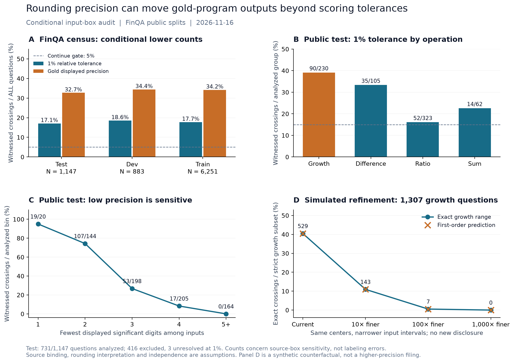

# T1：财报输入舍入精度的当日研究结果

日期：2026-11-16，America/New_York。任务：[T1_rounding.md](../../tasks/T1_rounding.md)。已阅读前序“构建可认证金融语言模型研究计划”对话中的研究转向、失败结果和最新绝对评分结论；本任务独立执行，没有沿用旧实验的分数或成功标准。

## 1. 结论及它实际回答的问题

**继续。** 公开 test 的 196 / 1,147 = **17.09%** 已找到超出 1% 容差的一致输入见证；增长率组 90 / 230 = **39.13%**。原任务的 5% 全体门槛与 15% 分组门槛均被超过，判定不依赖临界值处理，也不依赖样本很小的“其他”组。

精确研究量是：给定原 gold program (f)、成功绑定的输入及独立半末位舍入盒 (B)，是否存在 (z\in B)，使 (f(z)) 超出指定 gold 接受区间。数值运算使用精确有理数；越界见证取在舍入区间内部，避免舍入 tie 的端点问题。

它有三个边界：

1. 输入绑定、舍入解释和独立盒是模型假设，尚未对所有题目逐条验证。文档的其他披露、会计恒等式或离散约束可能缩小可行域。**17.09% 不是“全文不可回答率”的证明下界。**
2. FinQA 可合理地把显示数字作为算术输入。隐藏末位变化会改变经济量，并不自动使原基准任务无解，也不自动使 gold 标注错误。
3. gold program 可能不忠实于题意。本轮按其原样执行，不修正程序语义；中心值与答案不一致另行处理。因此也没有测量模型的正确率或投资价值。

## 2. 查重：方法已有，完整测量暂未检出

已完成集中定向检索、31 个子任务检索式及主代理补充查询，并核验相关全文/官方源码。本次没有声称用满半天壁钟，也没有把未检出当成新颖性证明。完整查询和差异见 [literature.md](literature.md)。

最接近的三项：

- [XBRL Calculations 1.1](https://www.xbrl.org/Specification/calculation-1.1/REC-2023-02-22%2Bcorrected-errata-2024-02-14/calculation-1.1-REC-2023-02-22%2Bcorrected-errata-2024-02-14.html) 已定义财务舍入区间、区间加总及一致重复事实的区间交集。这些不是本研究的新理论。
- [VeriFin §3.6](https://arxiv.org/html/2608.10213v1) 把源操作数固定，再给候选输出半末位容差；未见输入区间经 FinQA gold program 传播的比例审计。
- [FinVerBench](https://arxiv.org/html/2605.29586v1) 已研究显示舍入如何影响财务错误的可观测性及检出。它与 T1 相邻，但未给本次 QA 程序的发生比例。

因此没有触发“同样问题与同样测量已做过”的停止规则。若后续出现完整先例，应按原规则停下；当前贡献定位为条件性的基准审计。

## 3. 数据、来源绑定与判分

FinQA 固定官方提交 `0f16e2867befa6840783e58be38c9efb9229d742`：train 6,251、dev 883、public test 1,147，合计 8,281。数据及许可、TAT-QA 可行性见 [sources.md](sources.md)。未训练、未调用模型或付费 API。原始文件可由下载器取得，未重复提交大型原始数据。

来源优先使用 `table_ori` 和 gold 支持的文本；以行标签处理多层表头错位，保留 `5.0` 末尾零、百分号及括号负数。来源身份/精度不唯一、可能精确计数或契约值、常量角色含混、同一数字在同一步可能指不同经济角色的题目排除。处理不了的 table 操作与数值格式明确排除。规则和修正过程见 [protocol.md](protocol.md)；实现不是完整的财务语义解析器。

`const_*` 不能一律当数学常量，例如 dev 的 `divide(637,const_5)` 实际用到表中 5.0 billion transactions。程序重复引用同一已绑定基数时共享取值；但“2014 和 2013 均为 2.6”的单个文字数值代表两个角色，不能用 x−x 恒为零来认证。

三种报告口径：

| 口径 | 接受区域/处理 |
|---|---|
| 主 gate：相对 1% | 围绕 `qa.exe_ans` 的闭区间，半宽 (0.01|y|)；零 gold 为零宽。中心原本不在其中者单列。 |
| gold 显示位数 | 恢复 `qa.answer` 字符串末位，分清比例/百分点尺度；只纳入中心兼容且尺度可确定的题。严格越出闭合舍入格才给见证；包络触及 tie 边界则不认证稳定。 |
| 官方精度补充 | 用五位小数的精确十进制格子作敏感性分析；这不是 Python 二进制 float 在边界上的逐位仿真。 |

官方 FinQA 的执行器在最后 `round(this_res,5)` 后和 `qa.exe_ans` 判等。因此任务指定的 1% 和 gold 显示位数应称审计规则，不称原始官方规则。[官方源码](https://github.com/czyssrs/FinQA/blob/0f16e2867befa6840783e58be38c9efb9229d742/code/evaluate/evaluate.py)

## 4. 全量计数

| split | 全部题 | 可分析 | 1% 有见证 | /全部题 | 显示格有见证 | /全部题 |
|---|---:|---:|---:|---:|---:|---:|
| **test** | **1,147** | **731** | **196** | **17.09%** | **375** | **32.69%** |
| dev | 883 | 588 | 164 | 18.57% | 304 | 34.43% |
| train | 6,251 | 4,018 | 1,109 | 17.74% | 2,138 | 34.20% |
| 全部 | 8,281 | 5,337 | 1,469 | 17.74% | 2,817 | 34.02% |

test 的 1% 规则：731 题中 196 有见证、532 在盒模型内认证稳定、3 未解决；相对于可分析题，越界为 26.81%。显示格规则：375 有见证、255 稳定、16 未解决、85 无法恢复尺度/精度或中心本来不兼容。官方五位十进制格补充有 693 个越界见证；这个窄口径不是主 gate 的依据。

全部 416 个 test 排除原因：来源身份不唯一 80、非数值答案 20、可能精确计数 75、未支持运算 39、常量来源角色含混 42、可能精确/语义量 29、来源未找到 81、数值参数格式未支持 30、已定义投资基点 8、相同数值的经济角色含混 8、中心不在 1% 区间 1、无可扰动输入 1、来源精度不唯一 2。它们不是稳定题。

这是固定公开数据集的枚举计数，没有把同页多问当成独立随机样本，因此不附加虚假的总体置信区间。若推广到其他财报，需要单独的抽样设计。

### test 按运算类型

| 运算组 | 可分析题 | 1% 有见证 | 组内比例 |
|---|---:|---:|---:|
| 增长率 | 230 | 90 | 39.13% |
| 差值 | 105 | 35 | 33.33% |
| 比率 | 323 | 52 | 16.10% |
| 求和 | 62 | 14 | 22.58% |
| 其他 | 11 | 5 | 45.45% |

组别由程序结构确定：增长率优先，然后比率、差值、纯求和、其他。组内比例分母是可分析题，不代表所有该类题目的总体率。“其他”只有 11 题，不据此作稳定一般结论。

### test 按每题输入的最少显示有效位数

| 最少显示位数 | 可分析题 | 有见证 | 比例 |
|---|---:|---:|---:|
| 1 | 20 | 19 | 95.00% |
| 2 | 144 | 107 | 74.31% |
| 3 | 198 | 53 | 26.77% |
| 4 | 205 | 17 | 8.29% |
| 5 及以上 | 164 | 0 | 0.00% |

这里按字符表示去掉前导零后计位，保留末尾零；不是对原作者“真实有效精度”的人工判定。运算类型、量级与位数相互混杂，这张表不识别位数的因果效应。



## 5. 可复核越界实例

test `BLK/2014/page_120.pdf-4`：2013 和 2012 租金及部分办公设备费用分别显示为 137、133 百万美元，程序 `subtract(137,133), divide(#0,133)`。中心为 (4/133\approx0.03007519)，存储 gold 为 0.03008；1% 接受域是 [0.0297792,0.0303808]。

见证取 2013 的 136.5005、2012 的 133.4995，均严格处于各自半单位区间内，仍显示为 137、133；输出为 (6002/266999\approx0.02247948)。这个具体可行向量证明盒模型内确有越界，结论不依赖区间外包络是否紧。

每道题均保存原 program、绑定位置、原字符串、半宽、精确分数端点、中心、见证或未解决原因。`results/per_question.jsonl` 的分数以分子/分母保存，同时给便于阅读的小数。

## 6. 同量的不同精度披露

完整 test 的 380 页经指定数值、单位和词语重合候选规则扫描，得到 54 个位置对、24 页。两名独立子代理分段逐页核对指标、年份、单位和口径，确认 **35 对**、否定 **16 对**、待定 **3 对**。这是内部 AI 来源核对，没有冒充真人专家标注。候选规则只覆盖部分表格—文字量级转换模式，不能宣称找到所有语义重复。

23 道题完成单来源中心替换（其他操作数不变），其中 **4 道**跨 1% 规则，**13 道**跨显示格；1 道原程序和人工答案符号已不兼容，未计为显示格跨界。逐对标签、否定理由和替换结果均在两份 review CSV 与 part1 substitutions CSV；汇总见 `results/duplicate_summary.json`。

4 道非零 gold 的 1% 跨界题为：

- `AAL/2015/page_114.pdf-1`：1,733 million 换成叙述的 1.7 billion；比例从 65.2731% 变为 64.0301%。
- `ADBE/1999/page_64.pdf-2`：gold 用 0.8 million，换成精表 772 thousand；更精细披露反而越出原中心的 1% 接受域。
- `UNP/2007/page_25.pdf-2`：3,277 million 换为 3.3 billion，增长率越界。
- `UNP/2011/page_24.pdf-4`：1,917 million 换为 1.9 billion，增长率越界。

另单列 `PNC/2014/page_111.pdf-1`：文字说两个年份都为 2.6 billion，精表分别为 2,616、2,572 million。原程序差为 0，按年份分别取精表后差为 0.044 billion，越出零宽相对容差，但仍落在整数答案“0”的显示格内。它需要两个经济角色，未与上述单来源替换混算。

否定例包括：168 thousand **不含**应计利息与 0.2 million **含**利息；2017 年表格和 2016 年叙述；摊余成本与公允价值。这些不能凭数值接近认作同量。

一致重复披露应在统一单位后取区间交集。**中心替换跨界证明计算出处敏感，不证明结合全部披露后的可行域仍越界。** 本轮主程序没有自动融合所有重复和会计约束；这是下一步需要解决的限制。

## 7. 增长率闭式与精度反事实

设 (g(a,b)=b/a-1)，输入半宽为 (h_a,h_b)，且 (|a|>h_a)。精确值域由四个端点比率 (b'/a'-1) 的最小/最大值得到。最大绝对偏差为

\[
R=\frac{|a|h_b+|b|h_a}{|a|(|a|-h_a)}.
\]

一阶近似是

\[
R_1=\frac{|a|h_b+|b|h_a}{a^2},\qquad R/R_1=\frac{|a|}{|a|-h_a}.
\]

当完整舍入单位相同为 (u)，(h_a=h_b=u/2)，所以原任务中的一阶式需乘 **1/2**。相对输出的一阶敏感度为 ((|a|h_b+|b|h_a)/(|a|\,|b-a|))，揭示接近零增长时相对误差放大。证明、负值情形和分母跨零边界见 [math_review.md](math_review.md)。这些是已有误差传播方法的具体推导，不是新定理宣称。

严格筛出 `subtract(b,a), divide(#0,a)`（可追加精确×100）、两个不同绑定输入且分母不跨零的 **1,307 题**：

| 输入半宽缩小倍数 | 精确越界题数 | 比例 | 一阶预测的错例数 |
|---|---:|---:|---:|
| 1 | 529 | 40.47% | 0 |
| 10 | 143 | 10.94% | 0 |
| 100 | 7 | 0.54% | 0 |
| 1000 | 0 | 0.00% | 0 |

其中 test 严格子集 214 题，对应 84、24、0、0。所有判断都围绕真实保存的五位 `exe_ans` 接受域，未把它替换成未舍入中心。一阶式在本子集的 5,228 次阈值判断上碰巧无错例；原精度下精确半径最多为一阶半径的 4/3，因此一阶式仍不能当严格界。

在全部 731 个可分析 test 题里，同样模拟缩小半宽，越界见证数为 196、35、0、0；缩小10倍时尚有1题未解决，100及1000倍时全部盒模型认证稳定。

以上固定当前中心并缩窄输入盒，是合成反事实。百万改成千若只是单位转换，数值和误差同时放大1000倍，结果信息不变；只有真实披露增加三位精度才接近这里的1000倍缩窄。当前尚未用原始更精细报告验证总体改善数量。

## 8. 复算与交付

Python 3.12 用标准库完成主分析；图依赖 Matplotlib 3.11.2、NumPy。先安装所需绘图库，然后在仓库根目录执行：

```powershell
python research/t1_rounding/download_inputs.py
python -m unittest discover -s research/t1_rounding -p 'test_*.py'
python research/t1_rounding/analyze.py
python research/t1_rounding/growth_analysis.py
python research/t1_rounding/find_duplicate_precision.py
python research/t1_rounding/review_duplicate_part1.py
python research/t1_rounding/summarize_duplicates.py
python research/t1_rounding/plot_results.py
```

候选人工标签是已保存的研究输入，重跑候选检测器不会自动重新进行语义核验；part2 CSV 的逐条替换精确数值与理由一并保留。所有路径相对本目录或仓库，下载固定上游版本。19 个算术/源解析回归测试通过，增长率精确公式与通用包络的 5,228 次检查通过，图已实际打开检查。

交付入口为 [一页结论](FABLE_ONE_PAGE.md)、[汇总图](results/rounding_summary.png) 和本目录中的逐题证据/分析代码。TAT-QA 已取得并检查结构，但本轮没有运行其测量：它需要另一套中缀解析与来源绑定，JSON 数值也不能恢复全部原始答案末尾零。本轮不将这些工作写成已完成。

## 9. 下一步的可否决问题

应继续测试：**加入同量重复披露及明确会计约束后，已确认的金融金额题是否仍有足够多的答案越界？** 优先复核196个test见证中的真实报告精度与语义角色，再独立取新数据验证。若收紧后的比例降到原停止门槛以下，就停止全文不确定性主张，只保留来源精度敏感性现象。若现象保留，再判断审计发现是否足以构成论文；无需训练模型，也无需先建框架。
