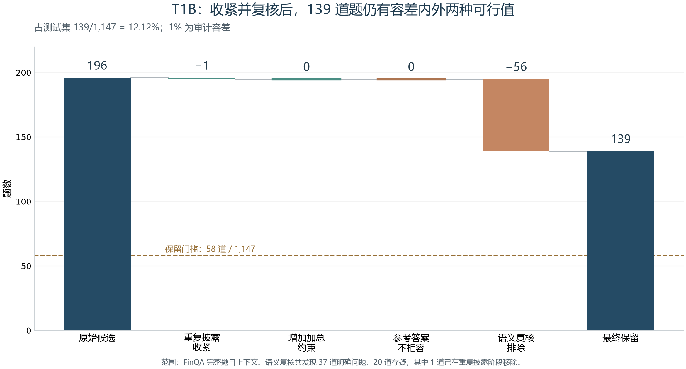

# T1B：完整 FinQA 上下文收紧检验

日期：2026-11-16，America/New_York。任务：[T1b_tighten.md](../../tasks/T1b_tighten.md)。基线为 T1 提交 `30acb8d`，未修改任何 T1 文件。用户明确选择本轮只审查 FinQA 提供的完整上下文，不扩展原始年报全文。

## 结果

**结论保留：139 / 1,147 = 12.12%，超过 58 道门槛。**

139 道题均满足三个条件：输入绑定和程序语义经本次逐条审查通过；存在严格位于全部非退化舍入区间内部、满足已确认线性约束的容差外有理数见证；同时存在满足同样条件的容差内见证。因此，它们确实存在“同样显示信息下，结果可以在接受区间内，也可以在外”的情况，不是仅仅把过宽的区间包络当成反例。

这仍是**舍入模型下的存在性结论**，不是答案通常错误的概率，不是模型错误率，也不是 FinQA 标注错误率。这里的相对 1% 是沿用 T1 的审计规则；[FinQA 官方执行器](https://github.com/czyssrs/FinQA/blob/0f16e2867befa6840783e58be38c9efb9229d742/code/evaluate/evaluate.py) 对最终数值保留五位小数后比较，不能把 1% 写成官方规则。



|步骤|本步移除|剩余候选|
|---|---:|---:|
|T1 原始 test 越界见证|—|196|
|同事实重复披露求交|1|195|
|加入已确认加总、差额及滚动等式|0|195|
|整段收紧区间与 gold 不相容，单列|0|195|
|排除其余明确语义问题与存疑题|56|139|

重复披露使 3 道题的输入盒变窄；进一步的线性关系使 9 道题的输出范围变窄，但没有新增题目整体进入 1% 容差。**收紧并非没有作用，只是大多数收紧未改变本次二元判定。**

互斥归因为：139 保留、1 重复披露数值确定、0 加总后数值确定、0 参考答案不相容、37 明确语义问题、19 其余存疑。语义复核总数实际是 37 明确问题与 20 存疑；其中 MSI 的 1 道存疑题已经在重复披露阶段移除，不能重复扣减。机器可读文件同时保留“语义优先分类”和“瀑布图顺序分类”。

## 数据与审查覆盖

固定 FinQA 上游提交 `0f16e2867befa6840783e58be38c9efb9229d742`，test 全部 1,147 道。重新运行原始 T1 代码得到：196 `witnessed_outside`、532 `certified_inside`、3 `unresolved`、416 `excluded`；196 个见证 ID 与既有结果完全一致。原始输入和 T1 结果的 SHA-256 保存在 [manifest.json](manifest.json)。

本轮对 196 道的全部 `table_ori`、`pre_text`、`post_text` 逐条检查，没有把 `gold_inds` 当作唯一可用材料。每个操作数核查指标、实体、期间、单位和数量类型；同一经济事实的重复出处需要语义证据，不能只靠数值重合或区间相交。总计记录 21 条追加同事实披露，涉及 13 道题；其中多数与原出处同精度。扫描同时允许单位缩放和正负号转换，例如表格负损益与正文正损失幅度。

表格自动筛出 801 个数值关系候选（A 500、B 301），允许各项舍入半宽覆盖显示残差。逐条语义审查后，最终采用 **511 条线性关系，涉及 143 道题**；这些还包括正文明确给出的分项合计、差额以及同一事实连接，不与候选数一一对应。关系清单中有重复题引用同一报告关系，511 不是独立经济恒等式数。

“primarily due to”“significant components include”等非穷尽措辞没有被当作完整桥接；交叉审查因此移除了 PM 的一组关系、AMT 的 7 条等式，以及 CME 一条无法确认穷尽性的授信分解。CME 的强假设结果另存为敏感性分析，不进入主分析。缺号也没有自动当零：保留的零值解释和区间逐条记录。多层表头按原始物理位置核查，年份标签错误与真正绑定错误区分处理。

[review_a.json](review_a.json)、[review_b.json](review_b.json) 是完整审查底稿；对应 Markdown 便于阅读。[逐题摘要](results/question_summary.csv)、[约束清单](results/constraint_inventory.jsonl) 可直接筛选。

## 固定 40 题复核与纳入规则修正

按 ID 排序，用 Python `random.Random(20261116).sample(..., 40)` 抽取，名单见 [sample40.json](sample40.json)。40 道中 **27 通过、8 明确有问题、5 存疑**。

明确问题比例是 20%；若将存疑也视为未通过，比例为 32.5%。两者不能混称为“错误率”。为回应任务的四分之一风险门槛，本轮采用保守处理：不以 8/40 为理由直接通过，而是扩展到全部 196 道复核，修改纳入条件后重新计算。没有用抽样比例乘到全体，也没有为了贴合题意私自重写 gold。

修正后的纳入要求如下：

- 固定年份、年数、合同条款、政策目标、声明的每股股息或未缩放精确计数，不得仅因显示成整数或小数就加半末位噪声。
- 来源的指标、年份、单位必须与操作数角色一致；百万/十亿转换必须已在程序中完成。
- 增长率的期间与基期、比率的分子分母、求和的期数须符合题意；误用不同指标或漏项不能归因于舍入。
- 加权平均确认期不能自动决定第一年费用；若问题没有要求平均年化、也没有均匀确认假设，记为存疑。
- 题意或来源仍无法确认者全部排除，不按有利方向推断。

具体例子：CME/2017/page_89.pdf-4 将精确除数“3 年”绑定到 3.0% 税率；LMT/2014/page_77.pdf-3 将 1.3 billion 除以 804 million 而漏掉换算；ETR/2016/page_150.pdf-4 问三年却只加两年；STT/2009/page_25.pdf-2 倒置年份与分母。全部问题均有逐题理由。

`replay_t1.py` 新鲜重跑全部 1,147 道原始来源/程序规则，再将 196 道的明确审查记录应用为本轮纳入修正。139 道通过语义审查，全部保留了容差内外两种可行见证。**这不是另 951 道题的全文语义验收，也不是已开发完成的通用金融语义解析器。**

审查由 AI 代理逐条阅读并交叉检查，主管线复核证据与计算；它不是独立人类签字复核。40 道底稿完整保存在 [sample40_review.csv](results/sample40_review.csv)，可供后续人工验收。

## 数值方法与可靠性

把每个绑定输入和约束涉及的辅助事实表示为精确有理数区间。重复披露统一单位后求交，同一事实共享变量；表格分项和总额都保留自身舍入区间。加总等式作用于隐藏值，而非强迫显示中心完全相加。

仿射目标直接求 LP；线性分式目标采用 Charnes–Cooper 变换。HiGHS 仅提供候选解：原解、对偶下界及残差修正全部再用 `Fraction` 核验。任意有理数对偶乘子都可给可靠外界；只有可行端点达到证书界，才称为精确极值。非线性程序先算可靠坐标包络，再检查端点是否可行且达到界；本队列的 5 个非线性程序也完成了该认证。

最终 **196/196 个收紧范围均有精确极值认证**。所有 588 个阶段结果另由 `verify_saved.py` 从磁盘重新读取并验证，不调用优化器。保留的 139 对内外见证同样逐项检查；没有不可行约束集、求解未决或依靠舍入端点的保留结论。[solver_notes.md](solver_notes.md) 给出证明与边界条件。

计算框架遵循已有的舍入区间与重复事实处理思想：[XBRL Calculations 1.1](https://www.xbrl.org/Specification/calculation-1.1/REC-2023-02-22+corrected-errata-2024-02-14/calculation-1.1-REC-2023-02-22+corrected-errata-2024-02-14.html) §5.2、§5.4–5.7。该方法不是本研究的新定理。

## 四个可直接核对的案例

|题目|变化|结论|
|---|---|---|
|BLK/2014/page_120.pdf-4|137 与 133 的增长率精确范围仍为 `[2/89, 2/53]`，约 2.247%–3.774%。|重复披露和表格约束未消除问题。|
|ADBE/1999/page_64.pdf-2|正文 0.8 million 总额与表格 772 thousand 是同一余额；比率范围从 `[7/17, 3/5]` 缩至 `[140/309, 900/1543]`。|明显缩窄，但仍可跨越 1% 容差。|
|MSI/2008/page_69.pdf-2|正文 1.2、2.2 billion 损失幅度可由表格 1,201、2,199 million 收紧，范围成为 `[-1998/2401, -1994/2403]`。|数值上进入容差，但题目“decline”与损失增长存在语义问题，不能当作干净的修复案例。|
|CME/2010/page_69.pdf-2|仅在额外假设两项穷尽总授信时，才可用 term loan 420.5 加 revolver 945.5 million 代替约 1.4 billion；强假设下比率范围 `[18909/27320, 18911/27320]`，约 69.21%–69.22%。|强假设下整个范围高于原 gold 约 67.536% 的容差；但原文“including”不能证明完整分解，故主分析不施加该式，保留此题。|

MSI 另有已报告的 83% 损失增幅；转换到程序符号后的舍入区间覆盖上表已收紧范围，因此不改变这一数值判定。该题最终仍按语义存疑处理。

## 可作出的结论和不能替代的工作

允许的表述是：**在 FinQA 完整题目上下文中，使用本次确认的重复披露和线性会计约束收紧后，至少 139 个 test 问题仍具有跨越相对 1% 接受区间的、语义复核通过的舍入见证。** 比例以全部 1,147 题为分母，但“至少”仍以已声明舍入模型和列出的约束为条件，不是对所有未提取语义约束完备性的证明。

不能把它改写成原始年报全文必然没有更精确信息、17% 或12%题通常答错，或基准必须接受某种模型输出。FinQA 可以把显示数字本身定义为算术输入；T1B 的否决检验通过后，T1C 仍需检验这件事是否实际改变模型判分。

此外，本轮没有穷尽乘积、比率等非线性披露约束，也没有使用原始 XBRL taxonomy 自动证明关系语义。剩余工作是独立人类复核底稿与 T1C，而非声称本轮完成了这些任务。

## 复现

环境：Python 3.12.14、SciPy 1.18.1、SymPy 1.14.0、Matplotlib 3.11.2。版本与代码哈希见 [run_environment.json](results/run_environment.json)。原始数据不重复提交；先按 T1 的下载器取得固定版本。

```powershell
python -m pip install -r research/t1b_tighten/requirements.txt
python research/t1_rounding/download_inputs.py
python research/t1b_tighten/prepare.py
python research/t1b_tighten/replay_t1.py
python research/t1b_tighten/run_audit.py
python research/t1b_tighten/verify_saved.py
python -m unittest discover -s research/t1b_tighten -p "test_*.py"
python research/t1b_tighten/deliver.py
```

审查 JSON 是版本化的语义输入，复现时不再次随机生成判断。`prepare.py` 重建固定抽样、数据包和数值候选；`verify_saved.py` 可在已有结果上独立重放证书。绘图默认使用 Windows 微软雅黑，可用 `T1B_FONT_PATH` 指定本机中文字体。
