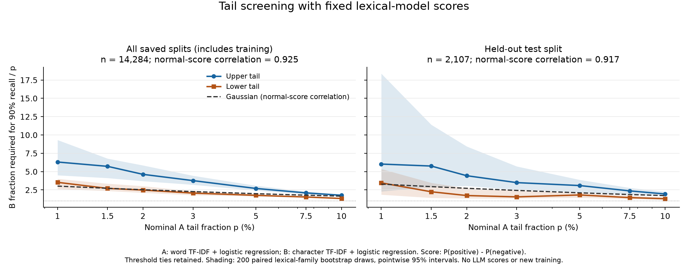
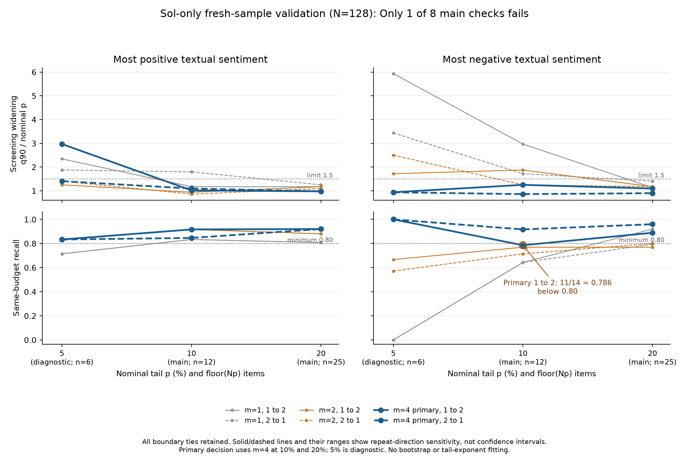

# What does a cheap model miss in the tail: full research deliverable for Fable

Passed on to Fable by Theodore | 2026-11-16 | Stage 1 and the new 128-item confirmation validation are both complete.

This report ties together the earlier five-path research, Fable's second-version direction, the mathematical and literature checks, the recomputation of the lexical baseline, and the agent experiments actually run in the current session. The raw results, inputs, prompts and analysis code are all kept. Internal AI review does not mean that Fable has reviewed the work; no material was sent to outside contacts. The current experiments did not train models, call external paid model APIs or use the user's API keys; 2.4B is treated as not trained. Luna and Sol, as specified by the tool, are experiment configuration names; their API prices, token costs and internal server versions were not measured.

## 1. Current assessment and work already completed

The first obstacle the research ran into was **the stability of the measurement**. When the same model is rerun on the same financial texts in a different order, it can give quite different extreme lists. So until a stable reference exists, cross-model tail differences cannot reliably be interpreted as what the cheap model misses.

**Final decision: this round does not move to 512 items. The improvement from four-run aggregation and the near-pass confirmation result are kept on record, but the verdict is not changed to success.** On the 128-item development sample, direct long-list ranking failed the scale-up conditions. Then, on 32 completely new items, pairwise comparison and four-run rank aggregation were run in full: both joint two-model routes failed; only Sol's four-run aggregation passed the single-model stability conditions. Following the user's request "scale up the method that passed", this branch was scaled up to another batch of 128 completely new items, with eight rankings completed. In this confirmation validation, seven of the eight main work items passed; in one direction, negative 10% recall was 11/14=78.6%, slightly below the 80% threshold. This is not proof of severe instability or of recall significantly below 80% in the population.

In total, **64 scoring agent tasks** were actually completed: 8 for the earlier development, 48 for the 32-item method comparison, and 8 for the new 128-item confirmation; in addition, 2 attempts at a whole batch of 496 pairs produced no output. Preparation, analysis and review agents are not counted as scoring runs. The three batches cover 288 distinct lexical families, one entity headline each; the two prompt versions in the earlier development reused the same 128 items. Stage 1 contains 3,968 pairwise judgments and 16 complete rankings, but its financial sample still has only 32 items, not 3,968 independent observations. Raw failures were not deleted, renamed, or replaced with the best run.

## 2. The research object, and the mathematics in the advisor's idea that had to be corrected

Let A be the reference model's score and B the candidate proxy's score; neither is an objective true return. The research object is restricted to upper-tail threshold screening on B: to keep a fixed share γ of the top p fraction of A, the minimum pass-through fraction needed is qγ(p). The core quantity is qγ(p)/p; the lower tail is computed separately. When the proxy relation is non-monotone, the upper-tail threshold need not be the optimal choice among all measurable screening regions.

After transforming the continuous margins to standard Laplace, if under the conditional distribution given A>u we have B=αA+A^βZ_u+o_p(A^β) with β<1, a tight residual and α>0, then A/u tends to 1 and B/u tends to α, and squeezing with a fixed interior conditional quantile gives:

**qγ(p)=p^{α+o(1)}.**

This is a logarithmic-order statement, not in general the ratio equivalence qγ(p)≈C p^α. For 0<β<1, if the residual target quantile zγ is identifiable, the correction is 2^{α−1}p^α exp{−zγ u_p^β+o(u_p^β)}; the little-o in the exponent cannot be dropped. For a finite positive multiplicative constant to exist, the conditional quantile offset bγ(u)−αu must tend to a finite value.

**α=1 does not guarantee a constant widening factor either.** The full derivation constructs a counterexample with exact Laplace margins: take a common exponential variable S and independent uniforms U, V, first set X=S+S^βU, Y=S+S^βV, then apply a common marginal transformation. It has α=1, yet qγ(p)/p=exp{γu_p^β+o(u_p^β)} tends to infinity. So a fitted α close to 1 cannot by itself establish that the cheap model's tail is reliable.

**α=ρ² for positively correlated Gaussians is a known result.** Heffernan–Tawn (2004) §8.6 already has the centering term ρ²u and the scale u^{1/2}; the Laplace residual variance is 2ρ²(1−ρ²). Here ρ is the normal-score correlation of the Gaussian copula, not the Pearson correlation of arbitrary raw scores. For fixed 0<ρ<1 the widening factor still diverges eventually, so being close to Gaussian in a finite p window cannot imply a constant rule over the whole range. The full quantile and multiplicative expansions for Gaussian fixed recall, and the endpoints ρ=0, negative correlation and ±1, are in the [full mathematical derivation](theory.md).

**Multi-stage α cannot be obtained just by multiplying pairwise fits.** A positive definite trivariate Gaussian with adjacent normal correlations of 1/2 each and endpoint correlation 0 is a counterexample. One needs joint propagation under the same original extreme condition, or suitable Markov transition conditions; recalls estimated unconditionally at each stage also cannot be multiplied directly into a total funnel recall.

**MES involves the expected payoff in the original units.** For the signed payoff (A−threshold)×proxy selection indicator, the sign of its expectation can be judged from the conditional mean on the proxy's tail; the payoff (A−threshold)_+ of a real option is nonnegative. The Laplace transformation preserves only order, not means, so a MES after transformation cannot be called investment value. This round's agent tasks involve only textual semantics, with no economic return ground truth.

The above is conditional mathematics and corrections, not a validated LLM law; nor is it claimed that these consequences alone are enough to make a new theoretical contribution.

## 3. Prior-art check: the broad contribution no longer holds, the narrow question remains to be tested

Four literature branches were actually checked, each recording the sections read and the access limits: [full literature report](literature.md). The closest prior work includes:

| Research branch | What existing work covers | What this project can no longer claim |
|---|---|---|
| Personnel selection and concomitant order statistics | Taylor–Russell Gaussian selection; Yeo–David screening by a correlated attribute; extreme dependence and concomitants | That proxy rank screening or Gaussian overlap rates are a new problem |
| Conditional extremes and extreme prediction | Heffernan–Tawn; finite-threshold corrections by Lugrin et al.; extreme prediction by Verma–Stoev et al. | That α=ρ², extreme prediction being governed by tail dependence, or general second-order corrections appear for the first time |
| LLM cascades | Zellinger–Thomson model tiers with copula and Markov relations and optimize cascades | Introducing model dependence into LLM cascades for the first time |
| Database proxy screening | Recall-target threshold selection in SUPG, BARGAIN and semantic filtering | Asking for the first time "how wide must the cheap proxy's net be cast" |

In the original papers read, we have not yet found the full combination "continuous financial semantic scores + two-tail widening curves at fixed recall + out-of-sample prediction". This is a bounded search conclusion, not a proof of non-duplication. The full text of Yeo–David (1984) has still not been obtained, and abstracts or secondhand citations cannot substitute for the prior-art check. The pairwise swaps of Qin et al. and the multi-permutation aggregation of Tang et al. are sources of the measurement design; we use midrank Borda and cannot inherit the theorems in Tang's paper, which are for the Kemeny method.

If the theory direction continues, what really needs solving is: how finite-threshold error affects the recall budget, and under what checkable conditions a tail regularity does better on new samples than the exact Gaussian and a direct empirical threshold. Merely inverting the conditional extremes formula into a power law does not accomplish this.

## 4. Lexical baseline: the phenomenon can be recomputed, but it is not LLM evidence

Using the previously saved word/char TF-IDF scores, with A=word and B=char, the score is P(positive)−P(negative). Pairing is by ID, all boundary ties are kept, and the models are not retrained. [Original recomputation report](one_page.md), [results JSON](baseline_results.json), [code](analyze_baselines.py).

| Scope | Nominal 1% positive widening factor | Nominal 1% negative widening factor | Corresponding Gaussian baseline |
|---|---:|---:|---:|
| All 14,284 items, including the training set | 6.31 | 3.54 | 3.02 |
| 2,107 test items, nominal 21 per tail | 6.03 | 3.46 | 3.29 |

On the test set, the nominal 95% ranges from a pointwise-paired lexical-cluster bootstrap are [2.29,18.38] and [1.86,5.36] respectively, with only 200 resamples; the models are fixed, training uncertainty is not included, and true events are not guaranteed to be independent. The descriptive log–log slope over a finite window is not the conditional-extremes α. The evidence supports "worth checking the two-tail difference"; it cannot prove that the same phenomenon exists for LLMs, nor financial investment value.

## 5. Measurement trials actually run

### 5.1 Direct long list: 128-item development sample, failure kept on record

The old test split has 2,107 rows in 1,570 lexical families. 128 families were drawn, one item each, without filtering by label or old predictions; labels and model results were masked. Two model tiers, two input orders and two prompt versions gave 8 fresh scorings in total. The first version treated every entity as an object of shareholder wealth; it ran into regulators, currencies, places and commentary sources, and Sol left 20 and 2 items unrankable in its two runs. It was revised to "the positive or negative expression and its strength in the financial context of the headline toward the specified entity", and the four new outputs covered everything, but this is a revision on the same development set.

After the revision, Sol's two runs had an overall rank correlation of 0.925; the nominal 10% negative lists actually had 12 and 14 items and overlapped in only 1; the two positive lists had 12 items each and overlapped in 11. Luna formed only 11 and 9 levels, and boundary ties expanded heavily. The cross-model widening curves therefore cannot be interpreted separately from same-model measurement fluctuation. The decision was to stop scaling up the direct long list; see the [development trial](agent_pilot.md) and the [one-page result](agent_result_one_page.md).

### 5.2 Stage 1: 32 completely new items, full comparison of pairwise and aggregation

Excluding the 128 development families, 32 families were drawn with a fixed rule from the remaining 1,442. Two panels were run on all 496 unordered pairs, with left and right swapped in each panel; each direction was split into 4 batches of 124 pairs, keeping the same 32-item context. The two models had 32 formal pair-scoring calls and 3,968 judgments. A win/loss was kept only when two preferences agreed; other non-U conflicts were merged into ties, and aggregation then used wins plus half ties. These merged ties are not all semantic equivalence.

The ranking route had 8 random orders and 8 new sessions per model, with the first 4 and the last 4 runs each forming a panel. Each run used within-group midranks, and the four runs were combined by equal-weight Borda; integer arithmetic kept true ties. All 16 rankings had complete coverage, with no inconclusive items. The m=1, 2 sensitivity results were also kept, and the best m was not reselected according to the results.

The main p=25%, nominal 8 items. For each model, both tails and both directions, all of the following had to hold: equal-budget recall ≥80%; q/p≤1.5 for 90% recall; boundary-tie expansion for A and B ≤20%; no inconclusive items. After rounding, 90% of 8 actually requires all 8. These are pre-specified working thresholds, not significance tests.

| Method/model | Rank correlation | Worst equal-budget recall | Maximum q90/p | Maximum tie expansion | Conclusion |
|---|---:|---:|---:|---:|---|
| Pairwise/Luna | 0.825 | 62.5% | 2.25 | 25% | Failed |
| Pairwise/Sol | 0.920 | 87.5% | 1.875 | 0% | Failed |
| Four-run aggregation/Luna | 0.865 | 87.5% | 2.75 | 0% | Failed |
| Four-run aggregation/Sol | 0.987 | 100% | 1.00 | 0% | Passed as a single model |

The left-right swap inconsistency rates were 50.0% and 46.4% for Luna, and 11.3% and 12.7% for Sol. Luna's merged graphs still had 8/508 and 7/543 strict three-edge cycles; Sol had no observed cycles among 1,964 and 2,125 strict triangles. Zero cycles do not prove transitivity in the population, and swap differences do not come only from position effects. Sol's pairwise route failed at the positive tail, where recalling 8 items required passing through 15 or 13.

Aggregation brought a real improvement. Sol went from a worst equal-budget recall of 36.4% and maximum factor 2.875 at m=1 to 100% and 1.0 at m=2 and m=4. Luna's equal-budget recall also improved, but at the positive tail it still needed to pass through 22 items to recover 8, a factor of 2.75. So the joint two-model method stays failed; the measurement cannot be declared valid on the basis of a higher correlation alone. [Full stage 1 report](stage1_report.md), [short conclusion](stage1_conclusion.md), [all numbers](methods_stage1_all.json).

### 5.3 New 128-item validation of the selected Sol four-run aggregation

After stage 1, the single passing single-model branch was explicitly selected. The 128 development families and the 32 stage 1 families, 160 families in total, were excluded; another 128 families were drawn with a fixed rule from the remaining 1,410, with zero intersection with all earlier families. Eight new orders and eight new Sol sessions were used, the prompt was kept byte-for-byte unchanged, and comparison was still between two four-run panels. The main p was changed to 10% and 20%, with 5% only as a diagnostic; the other thresholds were unchanged. The main denominator is still the nominal Np, not quietly swapped for floor(Np) or the actual tied count.

All eight outputs covered all 128 items, with 0 inconclusive items; the numbers of raw levels were 43, 77, 48, 28, 30, 42, 98, 98. The overall rank correlation of the four-run aggregation was 0.992865. The results are below; the ranges span only the two reference directions and are not confidence intervals:

| Tail and nominal p | Actual sizes of the two panels | Overlap count | Equal-budget recall in the two directions | q90/p range | Passed |
|---|---:|---:|---:|---:|---|
| Positive 10% | 12 / 13 | 11 | 91.7% / 84.6% | 1.016–1.094 | Yes |
| Positive 20% | 25 / 25 | 23 | 92.0% / 92.0% | 0.977–0.977 | Yes |
| Negative 10% | 14 / 12 | 11 | 78.6% / 91.7% | 0.859–1.250 | No: recall in the first direction |
| Negative 20% | 27 / 25 | 24 | 88.9% / 96.0% | 0.898–1.094 | Yes |

The maximum q90/p over all main checks was 1.25, below the 1.5 threshold; the maximum boundary-tie expansion was 16.7%, below 20%; only the negative 10% recall with panel 1 as reference failed. Finite counts and boundary ties make the two directions' recalls differ; 11/14 cannot be quietly swapped for 11/12 to declare success. For 90% recall, that direction actually needed to pass through 16 items, finally recovering 14; ties made the actual recall jump past 13/14 to 100%.

The reserved m=1, 2, 4 results were: worst equal-budget recall 64.3%, 71.4%, 78.6%; maximum q90/p 2.969, 1.875, 1.250. Aggregation does improve things, but the main method still did not meet all frozen conditions, so **we do not add repeats or change thresholds on this validation set and then relabel it a success, and we do not start the 512-item run**. [Item-by-item results](stage2_report.md), [full numbers](validation_stage2.json), [analysis code](analyze_agent_methods_validation.py).

This selection happened after stage 1, so it cannot be called a pre-specified success of the original two-model protocol. Going from 32 to 128 changed both the sample pool and the main tail fraction (25% to 10%/20%), so it cannot be attributed to "the larger the sample, the less stable". The appropriate conclusion is that the selected candidate failed the confirmation gate on a new sample and a stricter tail range, and the original tail research hypothesis remains untested. Even if Sol's stability had passed, it would only provide a candidate reference; it cannot fix the failure of the cheap branch or turn the reference model into objective truth.

## 6. Interpretation limits and alternative explanations

The input is the expression of a financial headline toward a specified entity, not a return, earnings shock or risk in common units. Ordinary facts, directionless text and entities that are only commentary sources can be tied at neutral. Fixing the format alone does not give a continuous latent variable; aggregation raising the number of levels also does not prove that the scores have escaped the context of the candidate pool.

This round's held-out status applies only to the training split of the earlier lexical models. We cannot confirm whether the headlines were seen in LLM pretraining; lexical families do not guarantee independent events. Fresh sessions do not guarantee independent errors, and the variation from random permutations is mixed with generation randomness, in-context comparison and other factors. The difference between the two panels and the range over the four cross-model combinations are only repeat sensitivity, not confidence intervals.

The instability may come from semantic ambiguity, entity roles, the standard for lexical strength or the candidate-pool context, or from the model's generation process. This trial did not causally separate these mechanisms, so they remain explanations, and no single story can be picked out and presented as a finding. No asymptotic α, real financial returns or paid API costs were estimated; there were no 100,000-item or 20,000-item API experiments, and work that was not run is not listed as a result.

## 7. Handoff of the five earlier paths

The old nine-round material is kept in full in the [historical summary report](../FABLE_FULL_REPORT.md). Each of the five analysis reports has its question, mathematical object, strongest alternative, evidence and rejection conditions, and none is deleted with this change of direction. They are historical alternatives, not five commitments being pursued at the same time.

| Path | Main insight | Entry |
|---|---|---|
| Information-set audit | The historical source and the whole training dependency chain are the weak link; a comparator with contamination removed is not automatically historically leak-free | [Path 01](../paths/PATH_01_audited_information_set.md) |
| Numeric sensitivity | Unit-invariant/monotone heads presuppose the correct semantic tuple; a simple sign(x−b) task does not need a language model | [Path 02](../paths/PATH_02_numeric_sensitivity.md) |
| Audit design frontier | The conditional mathematics is the most complete, but it must be compared with the strongest simple counting gate and whole-stratum random audits; it is a branch of 01 | [Path 03](../paths/PATH_03_audit_design_frontier.md) |
| Dependence-uncertain risk | Without information on common-error dependence, marginal calibration is not enough to identify batch risk; closest to the current interest in tail dependence | [Path 04](../paths/PATH_04_dependence_robust_risk.md) |
| Checkable numeric reasoning | Correct arithmetic and types do not mean the question is answered correctly; omission of candidate semantics remains the weak link; can provide tools for 02 | [Path 05](../paths/PATH_05_proof_carrying_numeric_reasoning.md) |

The old research's Top 3 were 01+03 merged, 02 and 04; an independent internal opinion once gave a different ordering, and the disagreement was not hidden by a vote. See the [five-path comparison](../paths/COMPARATIVE_ANALYSIS.md). The current user and Fable's second version explicitly changed to no training and no certificates, so the old "necessity of training from scratch" and the EDGAR access precondition are no longer execution gates for this round's agent measurements.

## 8. Substantive questions for Fable

First, can the current financial "semantic strength" carry a tail regularity with an economic interpretation, or should it first be restricted to a verifiable numeric task? Second, given the existing literature on copula cascades, extreme prediction and proxy screening, what finite-threshold result would be enough to form an independent mathematical contribution? Third, the candidate reference narrowly failed only one item on the new 128: does Fable accept closing it under the original gate, or setting up a new task and a new sample for validation? This confirmation set cannot keep being used as a development set while still claiming that it provides independent confirmation.

These are questions awaiting the advisor's ruling; they do not mean that Fable feedback has been received. What the current evidence supports is deciding to scale up or stop by the measured pass conditions, and keeping all failures; it does not support generalizing the lexical phenomenon directly into an LLM tail law.

The deliverable includes the raw inputs/outputs, the fixed protocol, the analysis source code, and the full mathematical/literature texts. Another independent AI context recomputed the 32 rows of stage 1 and the 36 rows of stage 2 with code that does not import the original analysis programs; the key counts, recall, pass-through, ties and cycles all agree, and no calculation error that would change the decision was found; see the [internal review report](measurement_peer_review.md) and the [independent recomputation code](review_measurements.py). This is not a review by Fable or by an outside human reviewer.

Recomputation only recomputes the saved judgments and does not need to call the models again; re-collecting outputs from agents with the same names cannot guarantee verbatim repetition. See the [recomputation notes](REPRODUCE_CURRENT.md). Historical and current results are distinguished by source, and historical hypotheses or advisor plans are not written up as completed research. The Markdown file of the same name that accompanied the PDF reading copy keeps the clickable sources and file links (PDF reading copy removed; this Markdown file is the source). The full mathematical proofs and the full texts of all old paths are kept in the package, and this report's summary does not replace them.
