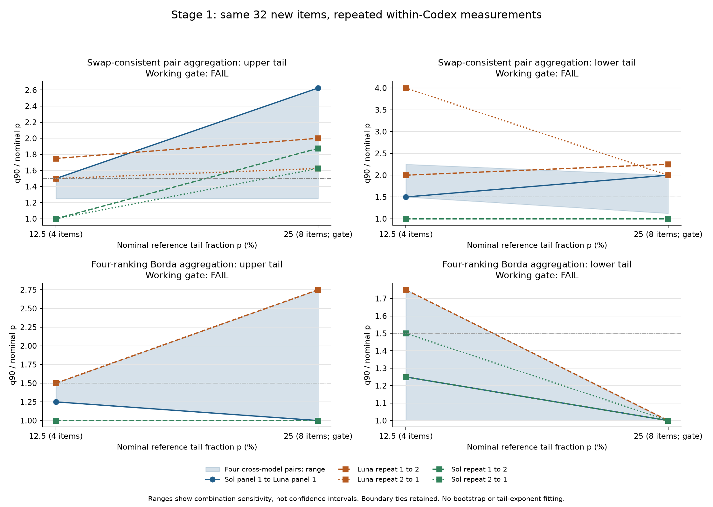

# 便宜模型在尾部漏掉什么：给 Fable 的完整研究交付

Theodore 转交 Fable｜2026-11-16｜第一阶段及新128条确认验证均已完成。

本报告串起此前五路径研究、Fable第二版方向、数学与文献核验、词法基线复算，以及当前会话实际执行的agent实验。原始结果、输入、提示和分析代码均保留。内部AI复核不代表Fable已审阅；没有向外部联系人发送材料。当前实验没有训练模型、调用外部付费模型API或使用用户API密钥；2.4B按未训练处理。工具指定的Luna、Sol是实验配置名，并未测量它们的API价格、token成本或服务器内部版本。

## 1. 当前判断与已经完成的工作

研究最先遇到的障碍是**测量的稳定性**。同一模型在相同金融文本上换序重复，可能给出相当不同的极端名单。因此，在形成稳定参照之前，跨模型尾部差异不能可靠地解释为廉价模型漏掉了什么。

**最终决定：本轮不进入512条；保留四次聚合的改善和接近通过的确认结果，但不改判成功。** 128条开发样本上的直接长列表排序未通过扩大条件。随后在全新32条上完整执行成对比较和四次排序聚合：双模型联合路线均未通过；只有Sol四次聚合通过单模型稳定性条件。按用户“通过的方法继续扩大”的要求，已将这一分支扩大到再一批全新128条，完成八次排序。该确认验证八个主工作项中七个通过，一个方向的负面10%召回为11/14=78.6%，略低于80%门槛。这不是严重失稳或总体显著低于80%的证明。

合计实际完成**64次评分agent任务**：旧开发8次、32条方法比较48次、新128条确认8次；另有2次496对整批尝试未产生输出。准备、分析与复核agent不计入评分次数。三批共有288个不同词法族、各一条实体标题；旧开发的两版提示复用了同128条。第一阶段包含3,968个成对判断、16份完整排序，但该阶段金融样本仍只有32条，不是3,968条独立观测。原始失败没有删除、换名或用最好的一次替代。

## 2. 研究对象，以及导师设想中必须修正的数学

令A是参考模型分数，B是候选代理分数；两者都不是客观真实收益。研究对象限定为B上尾阈值筛选：为留住A最高p比例中的固定份额γ，需要最少放行比例qγ(p)。核心量是qγ(p)/p；下尾另算。非单调代理关系下，上尾阈值不必是所有可测筛选区域中的最优选择。

将连续边际变为标准Laplace后，若在A>u的条件分布下有B=αA+A^βZ_u+o_p(A^β)，β<1、残差紧且α>0，则A/u趋于1，B/u趋于α，固定内部条件分位点的夹逼给出：

**qγ(p)=p^{α+o(1)}。**

这是对数阶，不一般是qγ(p)≈C p^α的比例等价。对于0<β<1，若残差目标分位点zγ可识别，修正为2^{α−1}p^α exp{−zγ u_p^β+o(u_p^β)}；指数里的小o不能删除。存在有限正乘法常数，需要条件分位偏移bγ(u)−αu趋于有限值。

**α=1也不保证常数放行倍数。** 完整推导构造了具有精确Laplace边际的反例：取共同指数变量S和独立均匀U、V，先令X=S+S^βU、Y=S+S^βV，再作共同边际变换。它有α=1而qγ(p)/p=exp{γu_p^β+o(u_p^β)}趋于无穷。因此不能以拟合α接近1直接判定廉价模型尾部可靠。

**正相关高斯的α=ρ²是已知结论。** Heffernan–Tawn（2004）§8.6已有中心项ρ²u、尺度u^{1/2}；Laplace残差方差为2ρ²(1−ρ²)。这里ρ是Gaussian copula的正态分数相关，不是任意原始分数Pearson相关。固定0<ρ<1时放行倍数最终仍发散，有限p窗口接近高斯不能推出全尺度常数规则。高斯固定召回的完整分位与乘法展开、ρ=0/负相关/±1端点均在[完整数学推导](theory.md)。

**多级α不能只凭两两拟合相乘。** 相邻正态相关各1/2、端点相关0的正定三元高斯就是反例。需要在同一个原始极端条件下联合传递，或满足适当Markov转移条件；各级无条件估计的召回也不能直接相乘成漏斗总召回。

**MES涉及原量纲的期望收益。** 对签名收益(A−阈值)×代理入选指标，其期望符号可由代理尾部上的条件均值判断；真实期权的(A−阈值)_+收益非负。Laplace变换只保持排序，不保持均值，不能把变换后的MES称为投资价值。本轮agent任务只有文本语义，没有经济收益真值。

以上是条件数学及修正，不是已验证的LLM定律；也未宣称这些推论足以单独构成新理论贡献。

## 3. 文献排重：宽泛贡献已不成立，窄问题仍待验证

四支文献已经实查并分别记录读到的章节和获取限制：[完整文献报告](literature.md)。最接近的先例包括：

| 研究分支 | 已有工作覆盖的内容 | 本项目不能再声称什么 |
|---|---|---|
| 人事选拔与伴随次序统计量 | Taylor–Russell的高斯选拔；Yeo–David按相关属性筛选；极端依赖与concomitants | 代理排序筛选或高斯重合率是新问题 |
| 条件极值与极端预测 | Heffernan–Tawn；Lugrin等有限阈值修正；Verma–Stoev等极端预测 | α=ρ²、极端预测受尾依赖决定或一般二阶修正首次出现 |
| LLM级联 | Zellinger–Thomson用copula和Markov关系建模模型档位并优化级联 | 首次将模型依赖引入LLM级联 |
| 数据库代理筛选 | SUPG、BARGAIN、语义过滤中的召回目标阈值选取 | 首次问“便宜代理的网要撒多宽” |

已读原文中，尚未找到“金融语义连续分数＋固定召回的双尾加宽曲线＋样本外预测”这一完整组合。它是有边界的检索结论，不是不重复证明。Yeo–David（1984）全文仍未取得，不能以摘要或二手引用替代排重。Qin等的成对换位及Tang等的多排列聚合是测量设计来源；我们采用midrank Borda，不能继承Tang论文针对Kemeny方法的定理。

若继续理论方向，真正待解决的是：有限阈值误差怎样影响召回预算；何种可核查条件让尾部规律在新样本上优于精确高斯和直接经验阈值。仅将条件极值式反演成幂次，没有完成这个任务。

## 4. 词法基线：现象可复算，但不是LLM证据

使用此前保存的word/char TF-IDF分数，A=word、B=char，分数为P(positive)−P(negative)。逐ID配对，边界同分全部保留；不重训模型。[原始复算报告](one_page.md)、[结果JSON](baseline_results.json)、[代码](analyze_baselines.py)。

| 范围 | 名义1%正面放行倍数 | 名义1%负面放行倍数 | 相应高斯基准 |
|---|---:|---:|---:|
| 全14,284条，含训练集 | 6.31 | 3.54 | 3.02 |
| 测试2,107条，每端名义21条 | 6.03 | 3.46 | 3.29 |

测试集逐点配对词法簇bootstrap的名义95%范围分别为[2.29,18.38]和[1.86,5.36]，仅200次重采样；固定模型，不包括训练不确定性，不保证真实事件独立。有限窗口log–log描述斜率不是条件极值α。证据支持“值得检查双尾差异”，不能证明LLM存在同一现象或金融投资价值。

## 5. 已实际执行的测量试验

### 5.1 直接长列表：128条开发样本，失败保留

旧测试划分有2,107行、1,570个词法族。抽128族各一条，不按标签或旧预测筛选；屏蔽标签和模型结果。两档模型、两种输入顺序、两版提示共8次fresh评分。首版把所有实体当成股东财富对象，碰到监管机构、货币、地点和评论来源，Sol两次分别20、2条不可排序。修正为“标题对指定实体的金融语境正负表达及强弱”，四个新输出完整覆盖，但这是同一开发集上的修正。

修正后Sol两次总体秩相关0.925，名义10%负面名单实际12、14条，只重合1条；正面两组各12条，重合11条。Luna只形成11、9个等级，边界同分大量扩张。跨模型放行曲线因此不能与同模型测量波动分开解释。决定停止扩大直接长列表，详见[开发试验](agent_pilot.md)及[一页结果](agent_result_one_page.md)。

### 5.2 第一阶段：全新32条，成对与聚合完整对比

排除开发集128族，从剩余1,442族固定抽32族。全部496个无序对做两个panel，每panel左右互换；每方向拆4批、每批124对，保留相同32条上下文。两模型共32个正式pair评分调用、3,968个判断。两次一致偏好才保留胜负，其他非U冲突合并为平局，之后用胜数加半平局聚合；这种合并平局并不全是语义等价。

排序路线每模型8个随机顺序、8个新会话，前4次与后4次各形成一个panel。每次组内midrank，四次等权Borda；整数运算保留真实同分。全部16份排序完整覆盖，无不可判断。另保留m=1、2敏感性，不按结果改选最佳m。

主p=25%，名义8条。两模型各自、上下尾、两个方向须全部满足：同预算召回≥80%；90%召回的q/p≤1.5；A与B边界同分扩张≤20%；无不可判断。8条的90%经取整实际要求全8条。这是事前工作阈值，不是显著性检验。

| 方法/模型 | 秩相关 | 最差同预算召回 | 最大q90/p | 最大同分扩张 | 结论 |
|---|---:|---:|---:|---:|---|
| 成对/Luna | 0.825 | 62.5% | 2.25 | 25% | 失败 |
| 成对/Sol | 0.920 | 87.5% | 1.875 | 0% | 失败 |
| 四次聚合/Luna | 0.865 | 87.5% | 2.75 | 0% | 失败 |
| 四次聚合/Sol | 0.987 | 100% | 1.00 | 0% | 单模型通过 |

成对左右交换不一致率Luna为50.0%、46.4%，Sol为11.3%、12.7%。Luna合并图仍有8/508及7/543个严格三边循环；Sol在1,964及2,125个严格三角中未观察到循环。零循环不证明总体传递，换位差也不只来自位置因素。Sol成对路线失败在正面端为召回8条需放行15或13条。

聚合有实际改善。Sol从m=1最差同预算召回36.4%、最大倍数2.875，提升至m=2和m=4的100%、1.0。Luna的同预算召回也改善，但正面端仍需放行22条才找回8条，倍数2.75。因此双模型联合方法保持失败；不能仅凭相关提高宣布测量成立。[完整第一阶段报告](stage1_report.md)、[简明结论](stage1_conclusion.md)、[全部数值](methods_stage1_all.json)。

### 5.3 选中Sol四次聚合的新128条验证

在阶段1之后明确选择唯一通过的单模型分支。排除开发128族和阶段1的32族，共160族；从剩余1,410族再固定抽128族，与此前所有族交集为零。八个新顺序、八个新Sol会话，提示逐字节保持不变，仍以两个四次panel比较。主p改为10%、20%，5%仅诊断；其余阈值不变。主分母仍是名义Np，不偷换为floor(Np)或实际同分人数。

八份输出全部覆盖128条，0条不可判断；原始等级数依次为43、77、48、28、30、42、98、98。四次聚合的总体秩相关为0.992865。结果如下，范围只跨两个参照方向，不是置信区间：

| 尾部与名义p | 两panel实际人数 | 重合人数 | 两方向同预算召回 | q90/p范围 | 通过 |
|---|---:|---:|---:|---:|---|
| 正面10% | 12 / 13 | 11 | 91.7% / 84.6% | 1.016–1.094 | 是 |
| 正面20% | 25 / 25 | 23 | 92.0% / 92.0% | 0.977–0.977 | 是 |
| 负面10% | 14 / 12 | 11 | 78.6% / 91.7% | 0.859–1.250 | 否：第一方向召回 |
| 负面20% | 27 / 25 | 24 | 88.9% / 96.0% | 0.898–1.094 | 是 |

全部主检查的最大q90/p为1.25，小于1.5门槛；最大边界同分扩张16.7%，小于20%；只有panel1作参照的负面10%召回未过。有限人数、边界同分使两方向召回不同，不能把11/14偷换成11/12后宣布成功。为90%召回，该方向实际需放行16条，最终找回14条；同分使实际召回跳过13/14达到100%。

预留的m=1、2、4结果分别为：最差同预算召回64.3%、71.4%、78.6%；最大q90/p为2.969、1.875、1.250。聚合确有改善，但主方法仍未满足全部冻结条件，**不在此验证集增加重复或改阈值后重标成功，不启动512条**。[逐项结果](stage2_report.md)、[完整数值](validation_stage2.json)、[分析代码](analyze_agent_methods_validation.py)。

这次选择发生在阶段1之后，不能称为原双模型协议的事前成功。32到128同时改变了样本池与主尾部比例（25%到10%/20%），不能据此归因为“样本越大越不稳定”。恰当结论是选中的候选未通过新样本与更严格尾部范围的确认门，原尾部研究假说仍未验证。Sol稳定即使通过也只提供候选参照，不能解决廉价支路失败或把参考模型变为客观真值。

## 6. 解释边界与替代解释

输入是金融标题对指定实体的表达，并非统一单位的收益、盈利冲击或风险。普通事实、无方向文本及仅为评论来源的实体可中性并列。仅修复格式不等于获得连续潜变量；聚合提高等级数也不证明分数已经摆脱候选池上下文。

本轮held-out只针对先前词法模型的训练划分。无法确认标题是否曾被LLM预训练见过；词法family不保证事件独立。fresh会话不保证误差独立，随机排列的变化与生成随机性、上下文比较等因素混在一起。两个panel差异及四种跨模型组合范围只是重复敏感性，不是置信区间。

不稳定可能来自语义含混、实体角色、词法强弱标准或候选池上下文，也可能来自模型生成过程。本试验没有因果分离这些机制，所以保留为解释，不能挑某个故事充当发现。没有估计渐近α、真实金融收益或付费API成本；没有十万条、两万条API实验，未执行的内容不列作成果。

## 7. 此前五条路径如何交接

旧九轮材料完整保留在[历史综合报告](../FABLE_FULL_REPORT.md)，五份分析报告各有问题、数学对象、最强替代、证据与否决条件，不在这次改变方向时删除。它们是历史备选，不是当前同时推进的五个承诺。

| 路径 | 主要认识 | 入口 |
|---|---|---|
| 信息集审计 | 历史来源和整个训练依赖链才是弱环；删除污染后的比较器不自动等于历史无泄漏 | [路径01](../paths/PATH_01_audited_information_set.md) |
| 数字敏感度 | 单位不变/单调头须以正确语义元组为前提；简单sign(x−b)任务不需要语言模型 | [路径02](../paths/PATH_02_numeric_sensitivity.md) |
| 审计设计前沿 | 条件数学最完整，但必须与最强简单计数门、整层随机审计比较；是01分支 | [路径03](../paths/PATH_03_audit_design_frontier.md) |
| 依赖不确定风险 | 缺少共错依赖信息时，边际校准不足以识别批次风险；最接近当前尾部依赖兴趣 | [路径04](../paths/PATH_04_dependence_robust_risk.md) |
| 可检查数值推理 | 算术和类型正确不等于答对问题，候选语义遗漏仍是弱环；可为02提供工具 | [路径05](../paths/PATH_05_proof_carrying_numeric_reasoning.md) |

旧研究的Top3是01+03合并、02、04；独立内部意见曾给出不同排序，未用投票掩盖分歧。见[五路径比较](../paths/COMPARATIVE_ANALYSIS.md)。当前用户和Fable第二版明确改为不训练、不写证书，因此旧“从零训练必要性”及EDGAR访问前提不再是这轮agent测量的执行门槛。

## 8. 给Fable的实质问题

第一，当前金融“语义强弱”是否足以承载一条有经济解释的尾部规律，还是应先限定为一个可验证的数值任务？第二，在已有copula级联、极端预测和代理筛选文献之后，什么有限阈值结论才足以形成独立数学贡献？第三，候选参照在新128条仅一项略未过门，Fable是否接受按原门收束，或另立新任务和新样本验证；不能把本次确认集继续当开发集后仍声称它提供独立确认。

这些是待导师裁定的问题，不表示已经收到Fable反馈。当前支持的是按实测通过条件决定扩大或停止，保留所有失败；不支持直接把词法现象推广成LLM尾部定律。

交付附带原始输入/输出、固定协议、分析源码及数学/文献正文。另一独立AI上下文已用不导入原分析程序的代码重算阶段1的32行及阶段2的36行，关键人数、召回、放行、同分、循环均一致，未见改变决定的计算错误；见[内部复核报告](measurement_peer_review.md)与[独立复算代码](review_measurements.py)。这不是Fable本人或外部真人审稿。

复算只重算保存的判断，不需要再次调模型；重新采集同名agent输出无法保证逐字重复。详见[复算说明](REPRODUCE_CURRENT.md)。历史与当前结果按来源区分，不把历史假说或导师计划写成已完成研究。阅读版PDF配套的同名Markdown保留可点击出处与文件链接；数学完整证明和所有旧路径全文随包保存，不以本报告的摘要取代。
