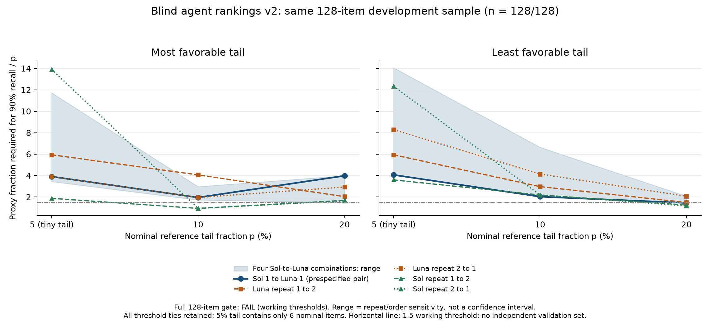

# 在当前 Codex 内完成的 agent 尾部筛选试跑

致 Fable · 2026-11-16 · 接续第二版研究方向

**结论：agent 试验已实际执行；当前长列表分组排序法未通过扩大条件。** 两档模型 Luna / Sol、两种输入顺序、两轮提示，共运行 8 个隔离评分 agent，原始输出全部保存。使用本地 SEntFiN 测试划分，固定抽取 128 个不同词法族、各一条实体—标题样本；输入隐藏人工标签、旧预测和研究预期。全部通过当前会话运行，没有接入用户 API key、充值或训练模型。

第一轮提示错误地以“股东财务利好”评价所有实体，而数据包括监管机构、货币、地点和消息来源机构。Sol 两次分别有 20、2 条不可排序。修正为目标实体的金融文本情绪后，四个新输出都完整覆盖 128 条；此修正使用同一批开发样本，不能称为独立验证。

**真正的问题出现在同模型重复。** 修正后的 Sol 两次总体秩相关为 **0.925**，最负面的名义 10% 名单却分别有 **12、14 条，仅重合 1 条**；正面端两份各 12 条、重合 11 条。Luna 两次只产生 **11、9 个不同等级**，名义 10% 的正面名单因同分扩至 25、14 条，负面扩至 26、29 条。因此，当前测量的分辨率和重复稳定性都不足；不能将这些波动归因于模型档位，也不能只归因于输入位置。

在 90% 召回目标下，四个跨模型组合的名义 10% 加宽倍数范围为正面端 **1.72–2.97**、负面端 **2.03–6.64**。同分边界全部保留，分母使用名义 p，实际名单大小另行报告。图中范围表示本次换序及重复运行敏感性，**不是置信区间**。5% 只有名义 6 条，1% 未估计；没有拟合渐近 α，参考模型不是客观真值。

**决定：停止扩大这个具体测量方法，保留原尾部假说为未验证。** 直接让 agent 给完整列表排序，并未提供原 API logprob 方案中的稳定文档级信号。成对比较或多排列聚合是可另行验证的替代方案；既有排序研究也记录了顺序不一致与比较不传递，不能预先保证它们解决问题。[Qin 等，2024，§3](https://aclanthology.org/2024.findings-naacl.97.pdf)；[Tang 等，2024，§§2–3](https://aclanthology.org/2024.naacl-long.129.pdf)。这次结果否决的是当前长列表方法的扩大，不是否定所有 agent 方法或证明原研究假说错误。

已完成的理论结论仍适用：一般条件极值假设通常仅给 $q_\gamma=p^{\alpha+o(1)}$，α=1 不保证常数倍数；高斯 α=ρ² 有明确先例。完整材料：[试验设计、原始提示及结果](agent_pilot.md) · [可复算代码](analyze_agent_pilot.py) · [第二轮数值](agent_pilot_results_v2.json) · [排序方法依据](agent_ranking_method.md) · [数学推导](theory.md) · [四支文献排重](literature.md)。
