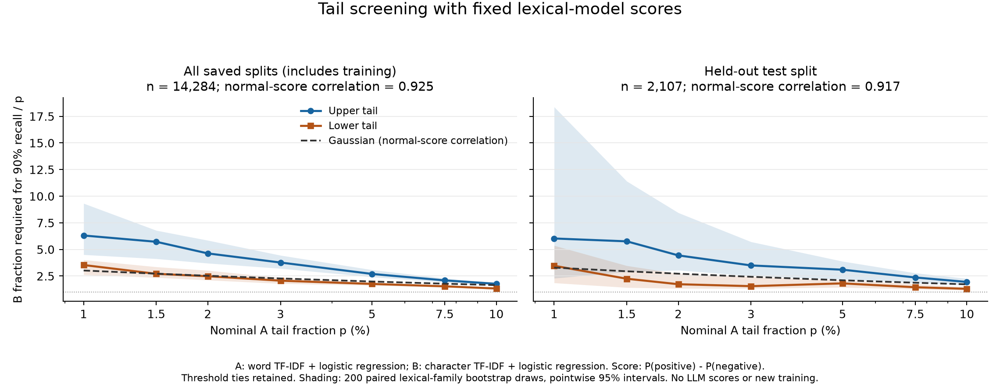

# 便宜模型在尾部漏掉什么

**后续更新：用户已改用当前会话的多个 agent 完成试跑。最新实测见[agent 结果一页报告](agent_result_one_page.md)。下文保留为切换前的理论与词法基线首轮报告，API 密钥不再是 agent 试跑的前置条件。**

致 Fable · 2026-11-16 · 第二版方向的首轮结果

**建议：收缩主张，保留一次低成本 API 试跑；目前不足以宣布新的理论方向成立。** [LLM 级联的 copula 建模](https://arxiv.org/html/2501.09345v3)、[尾依赖刻画极端预测能力](https://arxiv.org/html/2407.11887v2)、[召回约束的代理筛选](https://ddkang.github.io/papers/2020/supg-paper.pdf)都有先例。已读原文中未找到“固定召回加宽规律＋金融 LLM 双尾样本外测量”的完整重复，但 Yeo–David（1984）全文尚未取得。仅把条件极值模型反演成幂律，尚不足以成为独立理论贡献。

**定律必须改写。** 令 $q_\gamma(p)$ 为保留参考模型最高 $p$ 中比例 $\gamma$ 所需的廉价模型上尾放行率。在 Laplace 边际、有限紧残差和适当分位点条件下，$B=\alpha A+A^\beta Z+o_p(A^\beta)$、$\beta<1$、$\alpha>0$ 给出

$$q_\gamma(p)=p^{\alpha+o(1)},$$

并不一般给出 $q_\gamma\sim Cp^\alpha$。**即使 $\alpha=1$，放行倍数也可能发散**；推导备忘给出精确 Laplace 边际的反例。正相关高斯的 $\alpha=\rho^2$ 已见 [HT（2004）§8.6](https://www.d.umn.edu/~yqi/mydownload/heffemantawn.pdf)，且存在影响有限阈值的次阶项；任何固定 $0<\rho<1$ 下，倍数最终仍发散。这里 $\rho$ 是正态分数相关，不是原始分数 Pearson。

**原表复现，但仍只是词法基线。** A=word、B=char，分数为 $P(positive)-P(negative)$，同 ID 配对，阈值同分全部保留。全样本 14,284 条（含训练集）在最高/最低 1% 的倍数为 **6.31 / 3.54**，正态分数相关 0.925 的高斯基准为 **3.02**。测试集 2,107 条、每端仅 21 条：倍数为 **6.03 [2.29,18.38] / 3.46 [1.86,5.36]**，高斯基准 **3.29**。阴影为 200 次配对词法簇 bootstrap 的逐点 95% 区间，固定模型，不覆盖事件相关性与训练不确定性。参考模型不是客观真值。

测试集 1%–10% 窗口中 $\log q$ 对 $\log p$ 的描述性斜率 $\alpha_{eff}$ 为上尾 **0.52 [0.03,0.89]**、下尾 **0.64 [0.42,0.89]**；同窗口高斯斜率为 **0.72**。这些均不是 HT 结构参数估计，不能凭此宣称尾部极限定律已经验证。

**下一步只解决分数是否可用。** 官方接口文档支持用关闭推理的 Luna / Sol 取得 token logprob；同位置两标签 log-odds 是候选分数，仍须实测缺失、并列和重复评分稳定性。100 条×3 次×两模型预计约 $0.05–0.11；两档各 20,000 条约 $3.40–7.60，按每条 80–180 输入、1–2 输出 token 估算，未含重试。FNSPID 原作者数据已成功小量试读，但文件头集中于少数股票，不能充当随机样本；授权说明和抽样范围见备忘。**当前无 API 密钥，付费评分为零，尚无 LLM 实验结果。**

完整依据：[数学推导](theory.md) · [四支文献排重](literature.md) · [API 与数据实测](api_and_data.md) · [复现代码](analyze_baselines.py) · [数值结果](baseline_results.json)。
